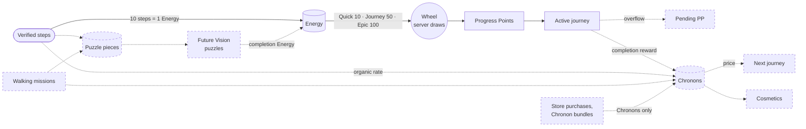
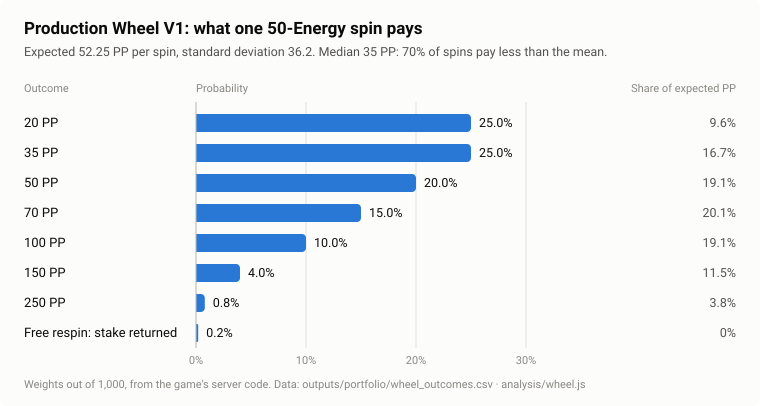
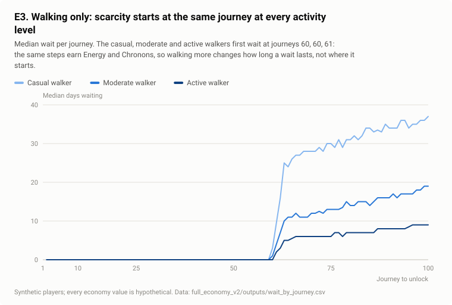
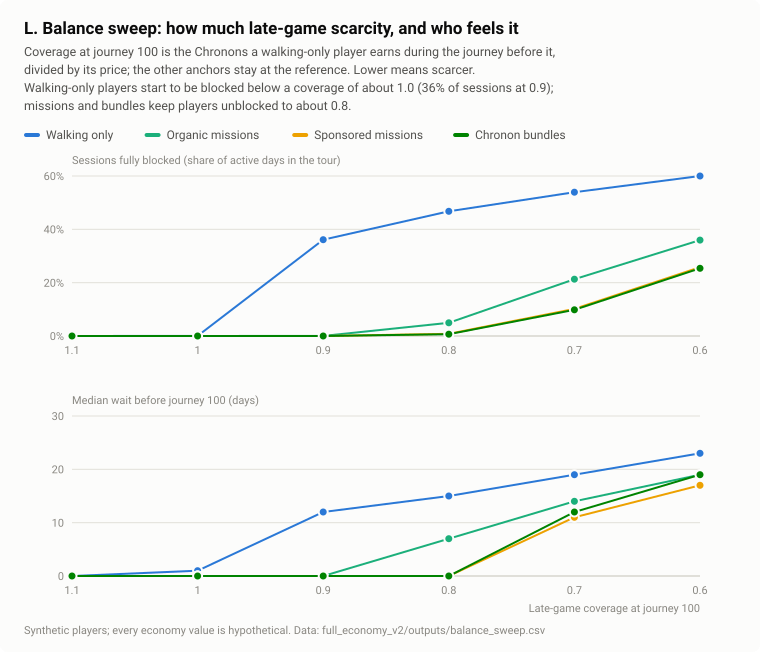

# Wellness Odyssey: Game Economy Design

*Or Hotoveli · Game economy and systems design · November 2026*

Wellness Odyssey is a mobile walking game. Real steps become **Energy**, Energy buys spins of a reward wheel, and the wheel pays **Progress Points (PP)** that carry the player along journeys to real-world destinations. **Chronons**, a planned second currency, open new journeys and buy cosmetics.

This repository is the game's economy design, from the implemented core loop to a planned 100-journey World Tour:
- closed-form mathematics;
- Monte Carlo simulation of synthetic players;
- interactive labs;
- a validated content-catalog format.

> **Pre-launch.** The game has no live players, revenue or commercial partners. Every player in this repository is synthetic, and every economy value is provisional until it is balanced with real playtesters. Nothing here is a forecast of player behaviour, retention or revenue.

| | |
|---|---|
| **My role** | Product owner and economy designer. I set the questions, made the design decisions, reviewed every result and directed the corrections (see [AI-assisted implementation](#18-ai-assisted-implementation)) |
| **Scope** | Wheel mathematics, core loop, 28-day pilot model, 100-journey projection, missions, puzzles, store, bundles, cosmetics, competition metrics |
| **Stack** | Plain JavaScript (Node 18+, no packages) for every current model and both dashboards; Python for the legacy model only |
| **Start here** | [V2 case study](full_economy_v2/docs/case_study.md) · [V1 case study](docs/v1_core_economy.md) · [V2 lab](full_economy_v2/dashboard/index.html) and [pilot lab](pilot/index.html) (download and open in a browser) |

---

## 1. The design problem

In most games the economy designer controls every faucet. Here the only real faucet is physical activity:
- it cannot be farmed inside the game;
- it varies several-fold between players;
- it reaches the game only when the player opens the app.

The designer controls conversion rates, caps, prices, sinks and content. The economy has to satisfy four requirements at once:

1. **Walking has to feel worthwhile** at 3,000 steps a day and at 10,000, without running out of content.
2. **A player who never pays** must always have a path to new content.
3. **Money may buy speed of access and self-expression**, but never physical progress or competitive standing.
4. **The economy has to last** across a planned 100-journey tour, not just the first week.

## 2. How to read this portfolio

Every claim carries a status. The four reader-facing categories:

| Category | Labels used in the documents | Meaning |
|---|---|---|
| **Implemented game mechanics** | Implemented · Implemented (legacy) | In the game's code today. Not validated with live players, because there are none |
| **Offline-demo behaviour** | Offline demo | Implemented in an isolated offline product demo. Not production |
| **Historical models** | Legacy | Earlier models, kept for their method and to show how the design iterated |
| **Hypothetical and future** | Planned · Option · Unset · Approved (modelling rule) · Proposed · Hypothetical | Approved product directions, options, deliberately undecided values, and exploratory inputs with no evidence behind them |

Results are additionally marked **Derived** (follows mathematically from the rules) or **Simulated** (output of a model run on synthetic players).

## 3. Economy architecture



*Solid: implemented (the production wheel is a fixed 50-Energy spin; the three tiers are offline-demo behaviour). Dashed: planned.*

| Resource | Role | Status |
|---|---|---|
| **Energy** | Fuel for spins. 10 verified steps make 1 Energy; daily milestones and quest arrivals add more | Implemented. The Energy cap is 250 in production code and 500 in the approved beta |
| **Progress Points** | Progress, not a currency: cannot be spent or bought | Implemented |
| **Pending PP** | A journey's overflow, kept for the next journey. Never pays a price or bypasses an unlock | Planned |
| **Chronons** | The access-and-expression currency. Sources: walking, journey completion, missions, store rewards, bundles. Sinks: journeys and cosmetics | Planned. Every rate and price unset or hypothetical |
| **Puzzle pieces** | Fill Future Vision puzzles; a completed puzzle pays Energy once | Planned; first puzzle in the offline demo |
| **Coins, Monument fragments** | Today's second currency and collectible | Implemented. The Coins-to-Chronons migration is an open decision |

**The governing rule** (approved). Buying Chronons may accelerate access to new journeys and cosmetics. Real money must never directly generate Energy, PP, journey progress or competitive score.
- **Spending does change timing.** A paying player can start the next journey sooner.
- **It doesn't buy the journey.** The journey itself still has to be walked.
- **One implemented exception.** Today's partner-purchase flow credits Premium Energy. It is documented as implemented legacy behaviour, superseded by this rule.

## 4. Wheel mathematics

The production wheel (implemented) has these properties:
- **Draw and payouts:** the server draws one of eight outcomes from integer weights out of 1,000, with payouts from 20 to 250 PP and a 0.2% free respin.
- **Expected value:** it pays **52.25 PP per 50-Energy spin**. That is 1.045 PP per Energy staked, or 1.0471 PP per Energy actually spent.
- **Shape:** right-skewed, with no single outcome carrying the economy.



The wheel went through three iterations.

| Version | Change | Finding | Status |
|---|---|---|---|
| **V1** | One 50-Energy spin | Exact expected value, spread and first-passage cost of a journey | Implemented |
| **V2** | Player-chosen stakes, 1–100, payouts scaled by stake ÷ 50 | Return per Energy is identical at every stake, but at stakes 1–3, **65% of outcomes** pay a fraction of a PP | Development only |
| **V3** | Quick 10 · Journey 50 · Epic 100 | Payouts are all whole **exactly when the stake is a multiple of 10**. V3 keeps the return and makes every reward readable | Offline demo |

**The lesson.** An economy can be mathematically correct and still fail at the moment of reward. Readability is a constraint on the maths.

**Competition.** The same maths shows why PP is a poor competitive metric.
- **Luck decides close contests.** At 10,000 steps, a player who walked 10% less still finishes ahead on PP 32.1% of the time on Journey Spin.
- **Tier choice becomes a gamble.** A trailing player who switches tier raises their chance from 15.7% to 20.2%.
- **The response.** Leagues and Duels are planned on a dedicated, verified-activity **Odyssey Score**; its formula is unset.

**Derivations:** [wheel economics](docs/wheel_economics.md) · [competition analysis](docs/planned_systems.md#5-odyssey-duels).

## 5. The 100-journey progression model

V1's 30-tester pilot model showed the near-term problem:
- in the baseline, 26.8 of 30 synthetic testers finish the first journey, half of them by **day 4.4**;
- after that, **82% of active days** leave Energy with nothing to buy.

Full Economy V2 projects the planned **World Tour** over six years:
- **Content:** the seven implemented destinations, then placeholders up to journey 100.
- **Prices:** Chronon-priced journeys.
- **Players:** 200 synthetic players per cohort.

**Two clocks set the pace.** A journey finishes only when walking has produced its PP *and* the player has paid its price:

```
unlock(k)  = max( finish(k-1),  steps at which the Chronon balance reaches price(k) )
finish(k)  = max( unlock(k),    steps whose PP covers journeys 1..k )
```

Early in the tour the PP clock binds, and later the Chronon clock does. Because the same steps earn both Energy and organic Chronons, the journey where a walking-only player first waits doesn't depend on how much they walk:

| Walking-only player | First wait for Chronons | Wait before journey 100 |
|---|---|---|
| Casual | journey 60 | 37 days |
| Moderate | journey 60 | 19 days |
| Active | journey 61 | 9 days |

**Prices as coverage.**
- **Coverage defined:** the designer chooses each journey's *coverage*, the Chronons a walking-only player earns during the previous journey divided by the price, at a few anchor journeys. Prices follow from those choices.
- **Coverage at or above 1** keeps walking-only players PP-bound.
- **Coverage below 1** introduces waiting.
- **Price families:** five families with the same total price differ only in *when* they charge, and that changes how the wait feels, not when the tour ends.



**Validation.** The projection is written in the same catalog format as V1's World Tour layer and passes its validator: no cycles, broken references or invented values. Undecided values stay *unset*, never zero.

## 6. Missions, puzzles, monetization and cosmetics

> **Hypothetical commercial inputs.** Every price, bundle, reward rate, commission rate, platform fee and monetization scenario in this section is a hypothetical modelling input. None is a production price or an approved business decision, and no partner or commission terms exist.

- **Walking missions (planned).**
  - Missions reward a verified walked route, not just arrival. The demo's provisional reference is 2 km for 90 pieces and 5 Chronons.
  - Missions pay per event, not per step, so they are worth most to the players who walk least. Removing late-game waits takes about 1 mission a week for a casual walker, 1.5 for a moderate one and 3 for an active one.
  - Organic missions keep the system open to players with no sponsor nearby.
- **Future Vision puzzles (planned).**
  - Pieces from walking and missions reveal landmark puzzles.
  - Completion Energy is 1.8% to 3.0% of all Energy credited and cannot help a Chronon-bound player.
  - A per-tile Chronon reward would be a large new faucet, not a free extra.
- **Wellness Store and bundles (planned).**
  - Store purchases reward Chronons valued at the bundle price. In the model, a hypothetical $4.99 bundle of 31 Chronons sets that value; it is not a proposed price.
  - At a hypothetical 8% commission, store rewards break even at 21.7% of order value if half of store Chronons displace bundle sales, and at 10.8% if all do.
  - Crediting store Chronons only after the return window avoids clawback debt.
- **Cosmetics (planned).** 28 proposed cosmetic-only items, enforced by a validator that refuses any gameplay field.
  - **Timing matters more than amount:** buying only from a surplus costs +13 days of tour time; reserving 20% of every Chronon costs +432 days.
  - **A finite catalog is a finite sink**, so a long-term sink needs a release cadence.

## 7. Player personas

V2 simulates eleven synthetic cohorts. Activity levels are median daily steps of 3,000, 6,000 and 10,000, with a session on 60%, 70% and 85% of days. These are modelling personas, not observed segments.

| Persona | Finish the tour within 6 years | Median day reaching journey 100 | First wait (journey) | Blocked sessions |
|---|---|---|---|---|
| Casual walker, walking only | 49% | not reached | 60 | 50% |
| Moderate walker, walking only | 99% | 952 | 60 | 54% |
| Active walker, walking only | 100% | 468 | 61 | 50% |
| Moderate walker, regular organic missions | 100% | 761 | 83 | 21% |
| Moderate walker, missions with a sponsor in reach | 100% | 699 | 93 | 10% |
| Moderate walker, Wellness Store shopper | 100% | 892 | 69 | 42% |
| Moderate walker, Chronon bundle buyer | 100% | 767 | 93 | 10% |
| Moderate walker, missions and cosmetics | 100% | 1052 | 28 | 75% |
| High-engagement collector | 100% | 592 | 2 | 80% |

*Simulated, reference calibration, hypothetical values. "Blocked sessions" are sessions in the tour where no journey is active and none is affordable. All eleven cohorts are in [results](full_economy_v2/docs/results.md#reference-cohorts).*

## 8. Free-to-play accessibility

- **No deadlock under the approved rule.** Organic Chronons keep accruing while no journey is active, so every price is reachable.
  - Moderate walking-only players finish on day 952.
  - Without the rule, 100% of them are stuck for good.
- **The free path doesn't depend on commerce.** With mission or store participation far below the reference, only the players who used them slow down; walking-only progression is unchanged.
- **Casual walkers are limited by journey length, not only by price.** On the reference pacing curve, 49% of casual walking-only players finish within six years. Tour length is a decision about who can finish at all.
- **Spending accelerates access without buying progress.** A bundle buyer reaches journey 100 on day 767, against day 952 walking only. The tests confirm that purchases never change Energy credited or PP per Energy.

## 9. Key findings

| # | Finding | Label |
|---|---|---|
| 1 | Stake scaling keeps return per Energy constant, so the stake changes variance and pace, not progress. Readable rewards require stakes in multiples of 10 | Derived |
| 2 | Content runs out first. The 28-day pilot model exhausts the first journey within days | Simulated |
| 3 | PP is unfit for competition at everyday volumes; a dedicated activity score is planned | Derived |
| 4 | Two clocks set the long-term pace, and where Chronon scarcity starts is a property of the catalog, not the player | Derived · Simulated |
| 5 | Missions are worth most to the players who walk least | Simulated |
| 6 | Under the approved rule the free path never deadlocks; without it, it always does | Simulated |
| 7 | Late-game scarcity appears as blocked sessions and banked Energy, not as a slower walk (section 10) | Simulated |
| 8 | Store rewards are fundable only with deferred crediting and a reward rate set against displaced bundle revenue | Derived (hypothetical inputs) |
| 9 | Cosmetics delay progression through timing, not amount | Simulated |

## 10. A discovered design risk: blocked sessions

> **This is a risk found in a hypothetical calibration, not a production result.** No real player has experienced it.

**The finding.** In the V2 reference calibration, late-game coverage is 0.7: Chronon prices outrun what walking earns. Synthetic walking-only players there are **fully blocked in 54% of their in-tour sessions**.
- **Banked Energy.** No spins can happen without an active journey, so 60% of their step Energy is credited while no journey is active.
- **Burst completion.** The bank then completes the next journey the moment it unlocks.
- **Why it matters.** The game cannot make a walking-only player wait *a little*: each Chronon-bound journey becomes a fully blocked wait followed by an instant completion.

**What it depends on.** The balance sweep shows the risk is a direct function of late-game coverage. Walking-only players are blocked in:
- 0% of sessions at coverage 1.0;
- 36% at 0.9;
- 54% at 0.7.

At 0.7, organic missions cut it to 21%.



**Why it is valuable.** It was found before launch, it has a measurable cause and it points to concrete levers. The planned difficulty curve (next section) is the response. Instrumentation for the pilot (`session_blocked`, `energy_banked_at_unlock`) is specified in the [V2 case study](full_economy_v2/docs/case_study.md#8-live-playtesting-requirements).

## 11. Planned: progressive difficulty, Accessible → Balanced → Challenging

> **Design direction, work in progress.** No stage boundary, coverage target or other value is set until the final calibration is approved.

The direction is a World Tour whose difficulty rises deliberately rather than at the point where the price schedule overtakes walking.

| Stage | Intended character |
|---|---|
| **Accessible** | Early journeys come quickly, and walking alone pays for the next one |
| **Balanced** | Walking roughly keeps pace; missions and puzzles start to matter |
| **Challenging** | Long journeys and bounded waits, with a free path always open. Missions matter most here, and spending shortens waits without buying progress |

**Guardrails that carry over:**
- no deadlock;
- money accelerates access, never progress;
- set the PP clock first;
- price as coverage;
- a free path that does not depend on commerce.

Rationale, guardrails and open decisions: [docs/progressive_difficulty.md](docs/progressive_difficulty.md).

## 12. Design implications

These are directions supported by the models, not final values.

1. **Set the tour's length (the PP clock) first.** It is the floor no price can beat, and it decides whether casual walkers finish.
2. **Design prices as coverage, not as a price list.**
3. **Give waiting time something to do, or avoid long Chronon-bound stretches.**
4. **Keep organic Chronons accruing while waiting.** It is what makes deadlock impossible.
5. **Rank competition on verified activity**, not on PP.
6. **Credit store Chronons after the return window, and set store and bundle rates as a pair.**
7. **Price cosmetics in weeks of income, surface them in surplus, and plan a release cadence.**
8. **Choose the Energy cap from measured sessions per day**, in the 30-tester pilot ([playtest plan](docs/playtest_plan.md)).

## 13. How the design iterated (historical)

| Iteration | What it found | What changed | Status |
|---|---|---|---|
| Early prototype | 50 steps per Energy, an 80-Energy cap and 16-Energy spins | 10 steps per Energy, 50-Energy spins, a 250 cap, seven destinations | Implemented |
| Seven-region simulation, October 2026 | Content lasted about three weeks, and the cap paced active players more than their walking did | A 500 cap for the beta; the content-exhaustion problem the World Tour now addresses | Legacy |
| Player-chosen stakes | Correct maths, unreadable fractional rewards | Wheel V3's three whole-number tiers | Development only → Offline demo |
| 30-tester pilot model, November 2026 | The first journey is done in days, then Energy has nothing to buy | World Tour, Chronons, prerequisite unlocking | Planned |
| Full Economy V2, November 2026 | A late-game price schedule turns scarcity into blocked sessions | The progressive difficulty curve (section 11) | Design direction, work in progress |

**The October 2026 model is historical.** Its [case study](docs/legacy_case_study_2026-10.md) and [sponsored-quest experiment design](docs/monetization_and_experiment.md) are kept for their method and as a record of the design. It used an illustrative wheel and a 500-Energy model cap, so its completion dates and commercial figures belong to that model, not to the current design.

## 14. Methodology and validation

1. **Closed form first.** Wheel expectation, spread and stake scaling are derived exactly. Journey cost uses an exact first-passage recursion, and contest odds come from exact convolution. The two-clock ledger is solved in closed form.
2. **Simulation second.**
   - **V1:** a day-by-day 30-tester, 28-day pilot model with 300 synthetic cohorts per scenario.
   - **V2:** a six-year model with 200 players per cohort, every Chronon tracked by source and sink. Random streams are separated, so cohort comparisons are paired.
3. **Data that refuses to guess.** Every hypothetical value lives in one labelled configuration file. The catalog validator rejects cycles, broken references, fractional or negative values and any literal labelled "verified".
4. **Invariants and mutation testing.**
   - **Invariants:** conservation of Energy, Chronons, pieces and PP on random scenarios; no negative wallets; purchases never touching Energy or PP.
   - **Mutation tests:** each safeguard is deliberately broken in a throwaway copy and must turn a test red. Paying the puzzle bonus at eight tiles, crediting Energy from a bundle and letting pending PP pay a price are all caught.
5. **Claim checkers.** Two scripts recompute every number quoted in the documents, confirm the generated tables and figures are current and resolve every link and anchor. This README is among the checked documents.

## 15. Reproduce

Requires Node.js 18 or later (tested on 24). No packages to install.

```bash
node --test                                   # V1: pilot engine and World Tour catalog tests
node full_economy_v2/scripts/run_tests.js     # V2: projection, simulation, store, cosmetics and dashboard tests
node analysis/check_claims.js                 # V1 figures, quoted numbers, outputs and links
node full_economy_v2/scripts/check_v2.js      # V2 outputs and quoted numbers; reruns the V1 checks (several minutes)
node full_economy_v2/scripts/mutation_check.js  # breaks 13 V2 safeguards one at a time (a few minutes)

node analysis/build_portfolio.js              # regenerate V1 tables and figures
node full_economy_v2/scripts/build_v2.js      # regenerate V2 tables, figures and results.md
```

**Dashboards.** Open [`pilot/index.html`](pilot/index.html) or [`full_economy_v2/dashboard/index.html`](full_economy_v2/dashboard/index.html) in a browser, from a local copy of the repository. They run the same engines as the tests, with no server and no network requests.

**Legacy model.** It needs Python 3.9+ with numpy and matplotlib: `pip install -r requirements.txt`, then `python economy_model.py`.

## 16. Repository map

| Path | What it holds |
|---|---|
| [`docs/v1_core_economy.md`](docs/v1_core_economy.md) | **V1 case study**: core loop, wheel V1–V3, pilot lab, planned systems summary |
| [`full_economy_v2/docs/case_study.md`](full_economy_v2/docs/case_study.md) | **V2 case study**: the 100-journey economy, missions, store, cosmetics, failure modes |
| [`full_economy_v2/docs/results.md`](full_economy_v2/docs/results.md) | Generated V2 results and fifteen design questions |
| [`docs/progressive_difficulty.md`](docs/progressive_difficulty.md) | The planned difficulty curve (design direction) |
| [`docs/`](docs) | Wheel economics, planned systems (Chronons, store, leagues, duels, World Atlas), pilot lab, playtest plan |
| [`analysis/`](analysis) | Wheel table and derivations, contest odds, V1 figure build, V1 claim checker |
| [`pilot/`](pilot) | V1 pilot engine, its dashboard, the World Tour catalog format and validator, V1 tests |
| [`full_economy_v2/`](full_economy_v2) | V2 configuration, engine, dashboard, scripts, tests and outputs |
| [`outputs/portfolio/`](outputs/portfolio) | V1 tables and figures |
| [`full_economy_v2/docs/demo_audit.md`](full_economy_v2/docs/demo_audit.md) | Read-only audit of what the offline demo implements |
| [`docs/legacy_case_study_2026-10.md`](docs/legacy_case_study_2026-10.md), [`docs/monetization_and_experiment.md`](docs/monetization_and_experiment.md), `economy_model.py`, `assumptions.csv`, `outputs/*.csv`, `outputs/*.png` | **Legacy**: the October 2026 seven-region model and sponsored-quest experiment design, kept to show how the design iterated. Both test suites read `assumptions.csv` for the implemented PP rule |

## 17. Limitations

- **No real players.** Every behavioural result is simulated, and nothing here shows retention, engagement or revenue.
- **Every economy value is provisional,** including the wheel table. Values not linked to the game's rules are hypothetical.
- **The projection's structure after journey 7 is hypothetical.**
- **Simplified behaviour.** Players are assumed to sync once per active day. Store orders and bundles are scheduled behaviour, not decisions, and there is no retention model.
- **The offline demo is not production,** and its validation was reported by its developer, not re-run here. The game's app code is private and not included.
- **The progressive difficulty curve is a design direction,** not a calibrated result.
- **Not modelled:** competition outcomes, the Coins migration, fraud and the next era's economy.

## 18. AI-assisted implementation

I built this portfolio with Claude (Anthropic) as an implementation partner.
- **Claude's part:** it wrote the simulation, analysis, test and checker code and drafted the documents from my game's rules and briefs.
- **My part:**
  - I set the design questions and made every product and economy decision;
  - I defined what counts as implemented, approved or hypothetical;
  - I reviewed the results;
  - I directed the corrections, several of which came from catching a claim the numbers did not support.
- **Guarding against plausible errors:** the claim checkers and mutation tests exist so that AI-written code and text could not quietly drift from the models.

## License

**All rights reserved.** This repository is published for viewing and evaluation as a portfolio; it is not open source. See [LICENSE](LICENSE).
