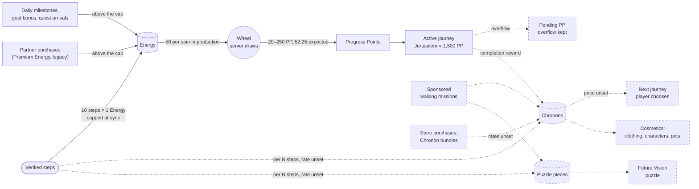
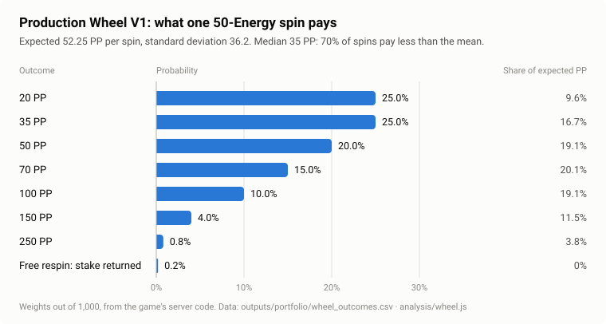
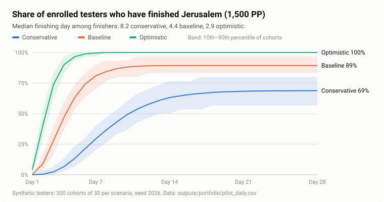
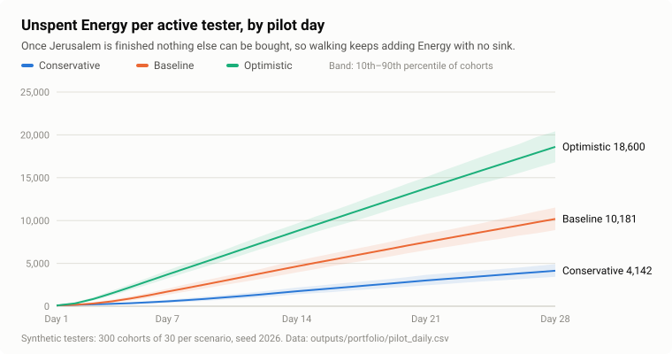

# V1: Core Economy, Wheel Mathematics and the 30-Tester Pilot Lab

*Or Hotoveli · November 2026 · part of the [Wellness Odyssey game economy portfolio](../README.md)*

> **This is the V1 case study.** It covers the implemented core loop, the wheel mathematics, the 28-day pilot model and the planned systems. The long-horizon 100-journey economy is [Full Economy V2](../full_economy_v2/docs/case_study.md). Commands below run from the repository root.

Wellness Odyssey is a mobile walking game. Real steps become Energy, Energy buys spins of a reward wheel, and the wheel pays Progress Points that carry the player along journeys to real-world destinations.

V1 holds the game's economy design:
- the mathematics of the wheel;
- simulations of synthetic players;
- a validated format for the content catalog;
- the design of the planned currency, store and competitive systems;
- a plan for tuning it all with real playtesters.

**This is a pre-launch portfolio case study.** The game has no live players. Every economy value here is provisional and will be balanced through live testing with real people.

| Label | Meaning |
|---|---|
| **Implemented** | In the game's code today |
| **Implemented (legacy)** | In the game's code today, but superseded by an approved product decision. Documented as it is; not yet removed |
| **Offline demo** | Implemented and tested in the isolated offline product demo. Not production |
| **Development only** | Behind a development-only flag. Not production |
| **Planned** | An approved product direction. Not built |
| **Option** | A design option under consideration. Not approved |
| **Unset** | Deliberately undecided. The models refuse to treat it as zero |
| **Derived** | Follows mathematically from implemented rules or reviewed values |
| **Simulated** | Output of a model run on synthetic players. Not observed behaviour |
| **Legacy** | An earlier model or finding, kept for its method and history |

## In three minutes

**The problem.** In most games the economy designer controls every faucet. Here the only real faucet is physical activity:
- it cannot be farmed inside the game;
- it varies widely between players;
- it arrives only when the player opens the app.

The designer controls conversion rates, caps, sinks and content. Walking has to feel worthwhile at 3,000 steps a day and at 15,000, without running out of content. In the full product it also has to stay fair while money buys access and cosmetics.

**The approach.**
1. **Closed-form maths first.** I derived the wheel's expected value, spread, stake scaling and contest odds exactly from the reviewed probability table, before any simulation.
2. **Monte Carlo simulation second.** A 30-tester, 28-day model (300 synthetic cohorts per scenario) shows where the economy runs out, inflates or stalls.
3. **Data structures that refuse to guess.** A World Tour catalog format whose validator rejects cycles, broken references and invented values. An undecided price stays *unset*, never zero.
4. **A playtest plan** that names which measured value decides each open parameter.

**Key findings.**

| # | Finding | Label |
|---|---|---|
| 1 | The reviewed wheel pays **52.25 PP per 50-Energy spin**: 1.045 PP per Energy staked and **1.0471 PP per Energy actually spent**. Scaling every payout by stake ÷ 50 keeps that return identical at every stake, so stake choice changes variance and pace of play, not progress per step | Derived |
| 2 | Small stakes produce fractional rewards: at stakes 1–3, **65% of outcomes** pay a fraction of a PP. Payouts are all whole **exactly when the stake is a multiple of 10**, which led to the Wheel V3 tiers of 10 / 50 / 100. They keep the same return | Derived · Offline demo |
| 3 | Content runs out first. In the baseline scenario 26.8 of 30 testers finish Jerusalem, half of them by **day 4.4**, and then **82% of active days** leave Energy with nothing to buy | Simulated |
| 4 | Puzzle completion depends on mission supply, not effort. With two participating businesses the first puzzle cannot be completed at all, and with four, about 1 tester in 30 completes it | Simulated |
| 5 | **PP is a poor competitive metric at everyday volumes.** A player who walks 10% less still finishes ahead on PP about a third of the time at 10,000 steps, and choosing the riskiest tier raises a trailing player's odds. A tier choice that is neutral for progress becomes a gamble in a contest. This is why Leagues and Duels are planned on a dedicated Odyssey Score instead | Derived (mathematical analysis) |
| 6 | The earlier seven-region model found the content-exhaustion pattern at a larger scale: active players finished all seven regions in about three weeks, and the Energy cap paced them more than their walking did | Legacy |

**How the design iterated.**

| Iteration | Trigger | Change |
|---|---|---|
| Prototype → current rules | The early prototype used 50 steps per Energy, an 80-Energy cap and 16-Energy spins | 10 steps per Energy, 50-Energy spins, a 250-Energy cap and seven regions. **Implemented** |
| Seven-region simulation (October 2026) | Content lasting about 3 weeks; the cap discarding 23–52% of step Energy | The same exhaustion problem the World Tour now addresses. The approved beta cap is 500. **On the development branch; production code has 250** |
| Player-chosen stakes | Exploring finer control over how Energy is spent | Wheel V2 stakes of 1–100. **Development only.** This exposed the fractional-reward problem |
| Fractional rewards | A 1-Energy spin could pay 0.4 PP: correct, but unsatisfying to see | Wheel V3: Quick 10 / Journey 50 / Epic 100, every payout whole. **Offline demo** |
| 30-tester lab (November 2026) | Jerusalem done in about 4 days, then idle Energy | World Tour, Chronons and prerequisite unlocking. **Planned** |
| Full-product direction (November 2026) | A walking game that also sells products and runs competitions needs one rule about money | Purchases reward Chronons only, for journey access and cosmetics; Wellness Store; Leagues and Duels ranked by a dedicated Odyssey Score; World Atlas. Spending can accelerate access and cosmetics, but never directly generates Energy, PP, journey progress or score. **Planned** |

**Where to look.**
- **Wheel maths:** [Wheel economics](wheel_economics.md).
- **Planned systems:** [Chronons, Store, Leagues, Duels and Atlas](planned_systems.md).
- **Interactive model:** [the pilot dashboard](../pilot/index.html) (open the file in a browser) and its [documentation](pilot_economy_lab.md).
- **Next step:** [the playtesting plan](playtest_plan.md).
- **Earlier work:** [the legacy seven-region analysis](legacy_case_study_2026-10.md).

---

## 1. The Core Loop

**Verified real-world steps → Energy → Wheel spins → Progress Points → journey progression.**
- **Implemented:** 10 verified steps make 1 Energy, and steps never award PP directly.
- **Planned:** Chronons, the second loop, open new journeys and buy cosmetics. They never produce PP or complete a journey.



*Solid: implemented. Dashed: planned. Premium Energy from partner purchases is drawn because it is in the code today. It is **implemented legacy behaviour**: the approved economy replaces it with Chronon rewards (section 7.1).*

**The governing principle** (approved): **buying Chronons is intentionally allowed to accelerate access to new journeys and cosmetic customization. Real-money purchases must not directly generate walking-based Energy, PP, completed journey progress or competitive Odyssey Score.**
- Purchases reward Chronons, which buy journey access and cosmetics.
- Energy, PP and journey completion come from verified walking.
- Earlier access is an intended benefit of spending. A paying player may start their next journey sooner, so spending does affect overall progression timing, but the journey itself still has to be walked.
- A non-paying player must keep a viable path to new journeys.

## 2. Sources and Sinks

| Resource | What it is | Sources | Sinks | Status |
|---|---|---|---|---|
| **Energy** | Spendable fuel | Steps at 10 per Energy; daily milestones and goal bonus; quest arrivals; Premium Energy from paid partner purchases (**implemented legacy behaviour**, superseded by Chronon rewards) | Wheel spins | Implemented |
| **Progress Points** | Progress, not a currency; cannot be spent or bought | Wheel spins | Fill journey costs | Implemented |
| **Pending PP** | PP beyond the current journey's requirement at completion | Journey overflow | Applied to a newly unlocked journey under the planned progression rules. Never pays a Chronon price or bypasses an unlock requirement | Planned. Partly present: final-destination overflow on the development branch; Jerusalem overflow in the offline demo |
| **Coins** | The implemented second currency | 10 at sign-up, daily milestones, quest arrivals, partner purchases | None yet | Implemented |
| **Monument fragments** | Collectible | Quest arrivals | Five-piece sets by default | Implemented |
| **Chronons** | The major planned currency: access and expression | Verified walking; journey completion; sponsored walking missions; eligible store purchases; direct purchase | Unlocking journeys; avatar clothing and accessories; character appearances; pets | Planned. Every rate and price **unset** |
| **Puzzle pieces** | One general pool | Verified walking, sponsored walking missions | Reveal Future Vision puzzle tiles | Planned |

Daily milestones pay Energy and Coins once a day each, all above the cap:

| Steps in a day | 3,000 | 7,000 | 10,000 | 15,000 | Personal goal (default 5,000, minimum 1,000) |
|---|---|---|---|---|---|
| Energy | +50 | +75 | +100 | +150 | +100 |
| Coins | +25 | +50 | +100 | +200 | |

### 2.1 Energy caps

| Where | Bank cap on step Energy | Status |
|---|---|---|
| Production code | **250** | Implemented |
| Development branch and approved beta | **500** | Implemented on the development branch |
| Offline demo | 500 | Offline demo |
| The build pilot testers will receive | **Unverified** | To be checked before the pilot |
| Economy Lab default | No cap. A legacy switch applies 500 plus the daily bonuses | Simulation assumption |

**How the cap works.**
- It limits only Energy converted from ordinary steps, at the moment of a sync.
- Daily milestones, the goal bonus, quest claims and legacy Premium Energy are credited above it.
- Leftover steps under 10 carry to the next sync, and steps that would convert past the cap are not credited.

The legacy analysis showed why the cap matters: at one sync a day it discarded 23% of step Energy at 6,000 steps and 52% at 10,000, so it paced active players more than their walking did.

## 3. The Wheel

### 3.1 Production Wheel V1 (implemented)

One spin costs 50 Energy. The server draws an outcome with integer weights out of 1,000 and returns it, and the app only animates to the result.

| Outcome | 20 PP | 35 | 50 | 70 | 100 | 150 | 250 | Free respin |
|---|---|---|---|---|---|---|---|---|
| Weight of 1,000 | 250 | 250 | 200 | 150 | 100 | 40 | 8 | 2 |
| Probability | 25% | 25% | 20% | 15% | 10% | 4% | 0.8% | 0.2% |



| Quantity | Value | How |
|---|---|---|
| Expected PP per attempt | **52.25** | Σ pᵢ·aᵢ |
| Standard deviation | 36.21 | √(4,041.25 − 52.25²) |
| Median outcome | 35 PP | 70.2% of attempts pay below the mean |
| Expected Energy spent | 49.9 | 50 × (1 − 0.002). The free respin returns the stake |
| PP per Energy staked | **1.045** | 52.25 ÷ 50 |
| PP per net Energy | **1.0471** | 52.25 ÷ 49.9 |

**Two bases, kept distinct.**
- **Per attempted spin**, a refund counts as an attempt that paid 0 PP: 52.25 PP, or 1.045 PP per Energy staked.
- **Per Energy actually consumed**, the refunded stake was never spent: 1.0471 PP per net Energy.

The [wheel economics](wheel_economics.md) note gives both conventions.

**Design reading.**
- The distribution is right-skewed: most spins pay a little below the mean, and a few pay well above it.
- The middle four outcomes each contribute 19–20% of the mean, so no single outcome carries the economy.
- The 250-PP outcome is 3.8% of the mean: exciting, but not something a player can farm.

### 3.2 Stake scaling (Wheel V2, development only)

A development implementation, behind a debug-only flag that is off by default, lets the player stake 1, 2, 3, 5, 10, 20, 50 or 100 Energy. Each payout is the base payout × stake ÷ 50, so:

- **Expected PP is 1.045 × stake**, and expected Energy spent is 0.998 × stake. Return per Energy is **the same at every stake**. Betting big never pays better.
- **The standard deviation is 0.724 × stake.** Larger stakes only lump the same expected progress into fewer, swingier spins.

That linearity creates a presentation problem at the bottom end:

| Stake | 1 | 2 | 3 | 5 | 10 | 20 | 50 | 100 |
|---|---|---|---|---|---|---|---|---|
| Smallest payout (PP) | 0.4 | 0.8 | 1.2 | 2 | 4 | 8 | 20 | 40 |
| Share of outcomes paying a fraction of a PP | **65%** | **65%** | **65%** | **25%** | 0% | 0% | 0% | 0% |

The development code stores rewards in tenths and carries the remainder, so the accounting is exact. The player, however, sees results like **0.4 PP**: mathematically valid, but unsatisfying as a reward. Often the visible progress is "+0 PP", because the PP went into a hidden remainder.

### 3.3 Wheel V3: Quick, Journey and Epic Spin (offline demo)

Every payout is a whole number exactly when the stake is a multiple of 10. The binding case is 35 × stake ÷ 50 = 7 × stake ÷ 10. V3 therefore keeps exactly three tiers on the unchanged table:

| Tier | Stake | Steps per spin | Payouts (PP) | Expected PP | Jerusalem: PP-budget approximation | Jerusalem: exact expected attempts |
|---|---|---|---|---|---|---|
| Quick Spin | 10 | 100 | 4 · 7 · 10 · 14 · 20 · 30 · 50 | 10.45 | ≈ 143.5 | 144.23 |
| Journey Spin | 50 | 500 | 20 · 35 · 50 · 70 · 100 · 150 · 250 | 52.25 | ≈ 28.7 | 29.40 |
| Epic Spin | 100 | 1,000 | 40 · 70 · 100 · 140 · 200 · 300 · 500 | 104.5 | ≈ 14.4 | 15.05 |

**Two different numbers.**
- **The PP-budget approximation** is 1,500 ÷ expected PP per attempt. It ignores the last spin's overshoot past 1,500.
- **The exact expected attempts** are the expected first-passage time from 0 PP. They come from a dynamic-programming recursion over the payout table that counts each 0.2% refund as an attempt and includes overshoot ([`analysis/wheel.js`](../analysis/wheel.js)), and a Monte Carlo run agrees.

Overshoot adds about 0.69 attempts at every tier, which costs more Energy at larger stakes. The expected net Energy for Jerusalem is 1,439 at Quick, 1,467 at Journey and 1,502 at Epic, against a budget figure of 1,433.

**What V3 keeps.**
- the probabilities;
- the 0.2% refund;
- 1.045 PP per Energy staked, and 1.0471 PP per net Energy.

**What V3 changes.** Each tier shows its own whole-number payouts, so the player always sees a reward they can read.

**Status: implemented in the offline demo, not in production.** Production is still Wheel V1's fixed 50-Energy spin. I read the demo's source and tests (read-only) to confirm what it does:
- **The Odyssey Compass** labels each point with the real payout for the selected tier.
- **Reveal now** settles the needle on the already-drawn outcome within 420 ms, without changing it.
- **Frozen receipts.** Each draw is recorded before the animation, together with the balances before the spin. Leaving the screen cannot undo a result or grant a free reroll.
- **Single settlement.** A receipt settles once. A stale or repeated settlement is refused.
- **Refunds** return the stake.
- **The fractional-carry mechanism** is kept internally. With whole V3 payouts it carries nothing.
- **Below 10 Energy, spinning is disabled.** The remaining Energy is kept ("your 9 Energy stays yours"), and the player is offered a way back to walking.

**Validation reported by the demo's developer**, not re-run here:
- 76 tests passed;
- clean static analysis;
- a successful web build;
- a complete mobile browser walkthrough;
- no observed external requests.

**The main cost.**
- A new player's first spin needs 100 steps instead of 10.
- Up to 9 Energy waits for the next spin. It is kept, not lost.

Full derivations, the variance table and the presentation rules: [docs/wheel_economics.md](wheel_economics.md).

## 4. The Economy Lab: a 30-Tester, 28-Day Pilot Model

[`pilot/pilot_model.js`](../pilot/pilot_model.js) simulates every enrolled tester day by day. It runs 300 synthetic cohorts per scenario with seed 2026, and the [dashboard](../pilot/index.html) runs the same engine in the browser. Rules and proposed rewards are identical in every scenario; only behaviour changes. The dashboard tags its fixed rules "Model-verified": taken from the game's code and fixed in this model, not validated with live players. Full documentation: [docs/pilot_economy_lab.md](pilot_economy_lab.md).

### 4.1 Scenarios: hypothetical behaviour

| Assumption | Conservative | Baseline | Optimistic |
|---|---|---|---|
| Testers who ever open the app | 75% | 90% | 100% |
| Chance of a session on any day | 50% | 70% | 85% |
| Weekly dropout | 12% | 5% | 2% |
| Median daily steps | 4,500 | 6,000 | 8,000 |
| Share of Energy wagered on an active day | 60% | 80% | 90% |
| Participating businesses (one mission each) | 2 | 4 | 6 |
| Mission discovery / acceptance / completion | 8% / 30% / 50% | 15% / 50% / 70% | 25% / 70% / 85% |

### 4.2 Results (simulated)

| Metric (cohort of 30) | Conservative | Baseline | Optimistic |
|---|---|---|---|
| Testers with at least one active day | 22.6 | 27.0 | 30.0 |
| Testers who finish Jerusalem | 20.6 | 26.8 | 30.0 |
| Median finishing day, among finishers | 8.2 | 4.4 | 2.9 |
| Active days with nothing to spend Energy on | 63% | 82% | 89% |
| Unspent Energy at day 28, per active tester | 4,142 | 10,181 | 18,600 |
| Missions completed | 2.6 | 21.8 | 79.7 |
| Testers completing the first puzzle | 0.0 | 1.0 | 16.3 |
| Chronons earned per active tester (none can be spent) | 0.57 | 4.05 | 13.29 |
| PP beyond 1,500, per completed journey | 25.6 | 27.3 | 27.4 |





**What the model says.**
1. **Pricing the second journey is the decision the economy is most sensitive to.** Without one, Energy has no sink within days.
2. **Chronons accumulate with no sink** until a journey price is set.
3. **The puzzle completion bonus does not inflate Energy.** It is under 0.3% of Energy credited even in the optimistic scenario. Its reachability depends on mission supply.
4. **Overflow is small but visible.** About 27 PP, 1.8% of a journey, would be lost at each completion without the planned pending-PP balance.
5. **Missed sessions matter more than any reward.** In the baseline, 41% of steps fall on days without a session or belong to testers who never start, and they never reach the game.

### 4.3 How the model is validated

- **Closed-form checks.** The simulation reproduces 1.045 × stake PP per attempt exactly. In the lab's expected-value accounting, Jerusalem completes after exactly 144 attempts at stake 10 (1,500 ÷ 10.45, rounded up), and then spinning stops.
- **Invariants on 150 random configurations.** Energy sources minus sinks equals the balance. No wallet goes negative.
- **Mutation testing.** Each safeguard was deliberately broken in a copy of the engine, and each break turned at least one test red. Examples: paying the puzzle bonus twice; letting a stake exceed the budget; counting route steps twice.
- **Cross-checks.** [`analysis/check_claims.js`](../analysis/check_claims.js) derives the wheel figures from the probability table, confirms they equal the engine's constants, recomputes the figures quoted in these documents and confirms the generated tables and charts are current.

`node --test` runs 74 tests: 20 for the pilot engine and 54 for the World Tour catalog.

### 4.4 Limitations

- **Every tester is synthetic.** Activity, steps, the mission funnel, stake choice and spending are assumptions.
- **The wheel enters the lab as expected values.** Individual outcomes vary more than the model shows.
- **The lab's stake mix uses the eight development stakes, not the V3 tiers.** Expected PP per Energy is identical at every stake, but that alone does not make pilot results identical. Discrete stake affordability, Energy left below the smallest tier, journey overshoot and daily spending budgets can all shift completion timing and idle balances. Overshoot alone means Jerusalem costs an expected 1,439 net Energy at Quick Spin and 1,502 at Epic Spin. **A V3-specific rerun is needed** before any pilot result is quoted for V3.
- **The lab drops overflow PP, and it has no cap or daily bonuses by default.**
- **Not modelled:** retention as a decision, purchases, cosmetics, competition, revenue, fraud and Coins.

## 5. Design Iteration and Tradeoffs

**The wheel is the clearest iteration.**
- **V1** gave one choice: a 50-Energy spin.
- **V2** let players stake 1–100 Energy at the same return per Energy. It was mathematically sound, but at small stakes most rewards became fractions such as 0.4 PP, or vanished into a hidden remainder.
- **V3** keeps the return and the probabilities. It cuts the choice to three tiers whose payouts are always whole, and accepts a 100-step minimum spin as the cost.

The lesson is that an economy can be correct and still fail at the moment of reward. Readability is a constraint on the maths, not decoration on top of it.

| Decision | Why | Tradeoff |
|---|---|---|
| The server draws every outcome; the app only animates | Outcomes cannot be manipulated from the client, and animation is purely presentation | The app must reveal honestly: no "Stop" button, no staged near-misses |
| Payout scales linearly with stake | Same return per Energy at every stake: no incentive to bet big, and progress per step is predictable | Variance grows with the stake; small stakes create fractions; in a PP contest, the tier becomes a variance lever (section 8) |
| Three tiers (10 / 50 / 100) instead of eight stakes | Whole-number payouts, real values on the wheel, three clear choices | The first spin needs 100 steps; up to 9 Energy waits |
| The cap applies only to step Energy at sync; bonuses bypass it | It paces heavy walkers and brings players back, while milestones keep long walks worth something | Rewards opening the app more than walking (legacy finding) |
| Prerequisite unlocking with player choice (planned) | Player agency, and a structure that scales to 100 destinations | Needs a validated graph: cycles, unreachable eras |
| One active journey at a time (planned) | A clear current goal; PP has exactly one destination | A player without the Chronons for the next journey cannot spin until it is unlocked. A player who buys Chronons can start sooner, by design (section 8) |
| Pending PP never pays Chronon prices or bypasses unlock requirements (planned) | Keeps progress and currency separate, so wheel luck cannot buy journeys | A pending balance to explain to players |
| Purchases reward Chronons for access and cosmetics; they never directly generate Energy, PP, journey progress or score (approved) | Keeps the health promise and competition credible, while letting spending buy speed of access | Premium Energy stays in the code as implemented legacy behaviour until it is retired; limits what can be sold |
| A dedicated Odyssey Score ranks Leagues and Duels, not PP (design direction) | PP is progression. The exact contest analysis shows the wheel decides many close PP contests and turns tier choice into a gamble | One more number to explain; formula, mission bonuses, fairness rules and rewards are unset |
| Organic earning from verified walking, never from logins (planned) | The faucet stays tied to the health promise | Lower floor for low-activity players |
| Sponsored missions reward a walked route, not arrival (planned) | Commercial content reinforces walking instead of driving to a shop | Route verification is harder than arrival verification |
| Unset values stay `null`, never 0 | An undecided price cannot silently become "free" | The catalog stays "not ready" until decisions are made |

## 6. World Tour Progression

### 6.1 Implemented: seven destinations

Each destination costs 1,500 × 1.08ⁿ⁻¹ PP, rounded to a whole point. The step figures are **derived** from the reviewed wheel: credited steps ≈ PP ÷ 1.0471 × 10. They exclude bonuses, the cap and missed days, so they are not completion forecasts.

| # | Destination | PP cost | Cumulative PP | Credited steps for this destination | Cumulative steps |
|---|---|---|---|---|---|
| 1 | Jerusalem | 1,500 | 1,500 | 14,325 | 14,325 |
| 2 | Dead Sea | 1,620 | 3,120 | 15,471 | 29,797 |
| 3 | Petra | 1,750 | 4,870 | 16,713 | 46,510 |
| 4 | Cappadocia | 1,890 | 6,760 | 18,050 | 64,560 |
| 5 | Burj Khalifa | 2,041 | 8,801 | 19,492 | 84,052 |
| 6 | Acropolis | 2,204 | 11,005 | 21,049 | 105,100 |
| 7 | Santorini | 2,380 | 13,385 | 22,730 | 127,830 |

### 6.2 Planned: the World Tour

**The World Tour turns the circuit into a roadmap.**
- About **100 present-day destinations** come first, followed by **historical eras** in later updates.
- Jerusalem is the free start journey, and the seven implemented destinations are the World Tour's first content.
- How destinations 2–7 sit in its prerequisite graph is still open.

| Rule | Design baseline | Status |
|---|---|---|
| Unlocking | A journey becomes eligible once every journey it requires is complete | Planned |
| Choice | The player chooses among eligible journeys they can afford. No single mandatory route | Planned |
| Active journey | One at a time | Planned |
| Start | Jerusalem is free | Planned |
| Price | Chronons. Pending PP never stands in for a price | Planned. Prices **unset** |
| Overflow | PP beyond a journey's requirement at completion is kept as pending PP, never silently lost. Pending PP does not bypass unlock requirements. Under the current design, no PP-generating spins happen without an active journey. When a new journey is unlocked, pending PP may be applied to it according to the planned progression rules | Planned. Partly present on the development branch and in the offline demo, as in section 2 |
| Eras | Every journey of an era is completed before the next era opens | Planned. Completion conditions **unset** |
| First journey of a new era | Free | Option |
| Future-era economy | — | **Unset** |

**Not final.** Journey prices, the prerequisite graph, era-completion conditions and the future-era economy are not finalized.

**The lab's illustrative catalog is not the editorial catalog.** It holds Jerusalem, Paris, Rome and Pisa, five puzzles and one collection. It exists to exercise the validator, not to propose content.

### 6.3 The World Tour catalog layer

[`pilot/world_tour.js`](../pilot/world_tour.js) defines the catalog format and two pure functions:
- `validateCatalog` refuses:
  - unknown keys and malformed ids;
  - broken references;
  - prerequisite cycles (found with Kahn's algorithm);
  - cross-era prerequisites and era chains that loop;
  - values that are fractional, NaN, infinite or negative;
  - any literal labelled "verified".
- `readiness` lists what a valid catalog still lacks.

**How values are written.** Every amount is one of:
- `null`, meaning unset;
- a labelled literal (`proposed` or `hypothetical`);
- a link to an engine constant.

There are exactly four links, so the catalog cannot drift from the model.

**Current state.** The illustrative catalog is valid but not ready: it has 28 unset values and an empty earlier era.

**Validation.** Fourteen deliberately broken guards were each caught by the tests.

## 7. Chronons, Missions and Monetization

Detailed design and open questions: [docs/planned_systems.md](planned_systems.md).

### 7.1 The Chronons economy (planned)

Chronons are the planned major currency, with two kinds of sink:
- **Access:** unlocking additional journeys.
- **Expression:** avatar clothing and accessories (hats, shirts, shoes), unique character appearances, and pets and other companions.

Chronons never generate PP and never complete a journey.

| Sources | Status |
|---|---|
| Verified organic walking (per N steps) | Planned. Rate **unset** |
| Journey completion rewards | Planned. Amounts **unset** |
| Optional sponsored walking missions | Planned. Provisional values in the offline demo |
| Eligible real-money purchases in the Wellness Store (configurable Chronons per dollar) | Planned. Rate **unset** |
| Direct Chronon purchases | Planned. Bundles and prices **unset** |

**Design notes.**
- **The non-paying path is a constraint, not an aspiration.** Organic Chronons earned while walking a journey, plus its completion reward, must reach the next journey's price. Prices and rates therefore have to be set together, and cosmetic prices draw on the same budget. The constraint is written out in [planned systems §2.3](planned_systems.md#23-the-non-paying-path-stated-as-a-constraint).
- **Coins and Chronons.** How the implemented Coins relate to Chronons, and what happens to existing Coin balances, is an open migration and design question. No conversion or migration rule is assumed.
- **Purchases reward Chronons**, and buying them is intended to accelerate access to journeys and cosmetics. Real-money purchases never directly generate Energy, PP, journey progress or Odyssey Score.
- **Premium Energy is implemented legacy behaviour.** Today's partner-purchase flow credits Premium Energy, which the wheel turns into PP. The approved economy replaces it with Chronon rewards. It stays documented as it is; changing the code is a separate task.

### 7.2 Future Vision puzzles and sponsored walking missions (planned)

| Element | Design | Status | Still open |
|---|---|---|---|
| **Future Vision puzzles** | Pieces come from one general pool and complete landmark-specific puzzles, revealing a cosmetic future-world view. A puzzle is available once its city's journey is unlocked | Planned. The first puzzle, Jaffa Gate, is in the offline demo: a 3 × 3 grid at 30 pieces per tile, with a 100-Energy completion bonus | Grid sizes, pieces per tile and rewards for later puzzles, collections and era transitions (**unset**). Jaffa Gate's values are provisional and are not generalized |
| **Sponsored walking missions** | Optional. They reward a verified walked route, not just arrival, and can accelerate Chronon and piece earning. Organic walking stays a meaningful source | Planned. In the offline demo, a medium mission pays 90 pieces and 5 Chronons for 2 km, as provisional values | Short and long mission rewards (**unset**); the billing unit for sponsors |
| **Step accounting** | Mission steps also earn ordinary Energy. Each physical step is credited once as step activity, and each mission is rewarded once | Planned | How de-duplication is enforced |

**What is implemented instead.**
- **Arrival quests** pay 150 Energy, 100 Coins and a Monument fragment on verified arrival, plus a 20% walking bonus, as reviewed in October 2026.
- Whether walking missions **replace** arrival quests or **sit beside** them is open.
- So is whether Monument fragments and Future Vision pieces are **one system or two**.

### 7.3 The Wellness Store (planned)

An in-app store of wellness, health and fitness products for a young, urban, fitness-interested audience. It supports:
- physical product sales;
- brand partnerships;
- Chronon rewards per dollar spent on eligible purchases.

Players can also buy Chronons directly.

**Not set:** no rate, price, margin, bundle, conversion rate, refund policy or revenue figure is set or forecast here. The economic questions are:
- purchase verification;
- refunds of purchases whose Chronons are already spent;
- keeping the store's rate and the direct-purchase rate coherent;
- the balance of paid against walking Chronons;
- cosmetics versus access;
- fair competition.

[Planned systems §3](planned_systems.md#3-the-wellness-store) works through each one.

### 7.4 Monetization research (historical)

The October analysis proposed **sponsored arrival quests**: three pricing models (fixed fee, cost per verified visit, hybrid), their hypothetical unit economics, seven strategic risks and a pre-registered non-inferiority A/B design. It remains a reference for method. Its commercial figures are hypothetical, and its billing unit is an *arrival*. Sponsored walking missions reward a *walked route*, so those unit economics do not carry over unchanged. See [docs/monetization_and_experiment.md](monetization_and_experiment.md).

## 8. Competition: Odyssey Leagues and Duels (planned)

**Odyssey Leagues** are leaderboards over daily, weekly, monthly and yearly periods, plus all-time rankings.
- Short periods give new players a winnable contest.
- Long periods give experienced players lasting status.

**Not claimed:** any retention effect.

**Odyssey Duels** are time-limited head-to-head challenges.

**Unset:** durations, matchmaking, rewards and scoring rules.

**The metric: a dedicated Odyssey Score** (design direction).
- PP stays the journey-progression resource. It is not the preferred ranking metric.
- Leagues and Duels are planned to rank a dedicated **Odyssey Score** that rewards verified activity, not wheel luck or spending.
- Its formula, mission bonuses, fairness rules and rewards are **unset**.

| Metric considered | Role and tradeoff |
|---|---|
| **Odyssey Score** | **Design direction.** Designed for fairness from the start; formula unset |
| Verified steps | Fair and legible, but no game strategy on its own |
| PP earned | **Not preferred.** Wheel randomness decides close contests (below), and PP accrues only with an active journey, which Chronons unlock |
| Completed physical missions | Geography and partner presence decide who can compete. How missions count in the score is unset |

**Why not PP: how much of a PP contest the wheel decides.** This is exact mathematical analysis, not observed player behaviour. Both players spend all their Energy at the same tier, and one walked 10% more. The table gives the chance that the one who walked less finishes ahead:

| Steps walked (less active vs more active) | Quick Spin (10) | Journey Spin (50) | Epic Spin (100) |
|---|---|---|---|
| 10,000 vs 11,000 | 15.7% | 32.1% | 36.5% |
| 50,000 vs 55,000 | 1.3% | 15.7% | 23.7% |
| 100,000 vs 110,000 | 0.1% | 7.8% | 15.7% |

The step totals are illustrative volumes, **not proposed duel lengths**. Only the number of spins matters: every 15.7% cell is 100 spins against 110.

**The variance lever.** With the opponent on Journey Spin at 50,000 against 55,000 steps, a trailing player who switches from Journey to Epic raises their chance from 15.7% to 20.2%. A tier choice that is neutral for progress becomes a gamble in a contest.

**Fairness.** Ranking an Odyssey Score built from verified activity keeps both wheel luck and spending out of competition. Legacy Premium Energy, a direct route from money to PP, does not reach that score.

**What spending changes, by design.** Buying Chronons can open the next journey sooner. A paying player may therefore resume spinning earlier than a walking-only player who is still earning Chronons. That timing effect is the intended benefit of access, not a purchase of progress: the PP still has to be earned by walking. Pending PP carries a journey's overflow across the gap, but under the current design no PP-generating spins happen without an active journey, so step Energy can reach the cap while a player waits. Open questions, none decided:
- how long a walking-only player should typically wait between journeys, set through journey prices and the organic Chronon rate;
- whether the cap should treat time without an active journey differently;
- keeping the Odyssey Score independent of whether a journey is active;
- excluding purchase-derived balances from anything ranked;
- grouping players by mission availability.

Analysis and data: [planned systems §5–6](planned_systems.md#5-odyssey-duels), [`outputs/portfolio/pp_contest_odds.csv`](../outputs/portfolio/pp_contest_odds.csv).

## 9. The Odyssey World Atlas (planned)

**Status: not implemented.** The offline demo has no Atlas today.

The Atlas is a two-level navigation system for the World Tour:
- **World Globe.** A premium, futuristic holographic globe for choosing countries and seeing the global roadmap.
- **Country Adventure Map.** A detailed, illustrated topographic map of each country.

**Real geography.** Unlike fictional RPG maps, each country map keeps real-world features: outlines and coastlines, major mountains and elevation, rivers, lakes and deserts, and every destination at its real coordinates.

**Art direction.** Fantasy adventure cartography in deep emerald, teal, brass and gold, with subtle cyan holographic accents.

**Journey nodes.** Each node shows one of three states:
- **playable**;
- **implemented but locked**, showing what unlocks it;
- **planned**, labelled "coming in a future update" and never shown as playable.

Selection is non-linear and follows the prerequisite graph, and future historical eras may be teased.

**First vertical slice.** The offline demo is intended to prioritize Israel, with Jordan and Italy as previews if feasible.

**Open questions:**
- the source and licence of the geographic data;
- the catalog fields for coordinates, country and node state, which the format does not yet have;
- the editorial placement of destinations.

See [planned systems §7](planned_systems.md#7-the-odyssey-world-atlas).

## 10. Open Questions and Live Playtesting

### 10.1 Open economic and product decisions

| Question | What it depends on | How it will be decided |
|---|---|---|
| **Journey pricing** in Chronons and journey lengths in PP | The target time per journey; the Chronon faucet | Agree a target first, then fit to measured steps ([playtest plan](playtest_plan.md)) |
| **Organic Chronon rate** per N verified steps | Journey prices; the non-paying-path constraint | Set jointly with prices; check the lab's idle-day share |
| **Retiring legacy Premium Energy** in code | The approved rule that purchases reward Chronons only | A separate engineering task, outside this documentation |
| **Waiting time between journeys** | How long a walking-only player waits for Chronons; whether capped step Energy is lost meanwhile | Set with journey prices and the organic Chronon rate; the cap rule is a product decision |
| **Store and direct-purchase rates**, refunds and verification | Paid against walking Chronons; abuse through returns | Product and policy decision; no values assumed |
| **Cosmetic prices** | The access budget they draw on | Set after journey prices |
| **Odyssey Score** formula, mission bonuses, fairness rules and rewards; league grouping and resets; duel length and matchmaking | Verified activity; geography; anti-cheat | Design review against the contest analysis |
| **Energy cap** for the pilot build: none, 250 or 500 | Measured sessions per day and the balance at sync | Verify the pilot build first, then measure discarded Energy |
| **Puzzle rewards** for later puzzles, collections and era transitions | Mission supply; whether puzzles should pay Energy at all | Playtest tile progress and leftover pieces |
| **Era transitions** and the future-era economy | Era-completion conditions; total length of the present-day era | Not testable in a 28-day pilot; needs a long-horizon projection layer, not yet built |
| **Chronons and Coins compatibility** | What happens to Coin balances; whether quest arrivals pay Chronons | Product decision; no migration rule assumed |
| **Arrival quests versus walking missions**, **fragments versus pieces** | Partner model; content production | Product decision |
| **Atlas geography data** and catalog fields | Licensing; the decision not to use a map SDK | Separate approval |
| **Odds communication** | Platform policy for random rewards; player comprehension | Policy review and the day-3 survey |

### 10.2 Live playtesting plan

About 30 testers for 28 days, run as a **calibration exercise rather than an experiment**: a proportion near 50% measured on 30 people has a 95% margin of about ±18 points.

| Measured | Decides |
|---|---|
| Daily verified steps and their variation | Journey lengths; pacing; how much of a contest walking decides |
| Sessions per day and the balance at each sync | Energy cap |
| Tier choice and steps before the first spin | V3 tiers; onboarding |
| Day each tester finishes Jerusalem; idle days afterwards | Second-journey price and length |
| Mission funnel and extra walking | Mission rewards and supply |
| Tiles, leftover pieces, Chronons held | Puzzle size; organic rates |
| Survey on days 3 and 28 | Comprehension of odds, tiers and pending PP |

Store, league and duel economics are outside what a 30-person pilot can measure. Full plan, instrumentation and analysis sequence: [docs/playtest_plan.md](playtest_plan.md).

## 11. Earlier Model: the Seven-Region Simulation (Legacy)

The October 2026 case study simulated 28 days of play for three synthetic profiles (3,000, 6,000 and 10,000 steps a day, 2,000 players each), with an illustrative wheel paying 1.0 PP per Energy and a 500 cap. Its findings were:

- the seven regions were a **three-week game** for anyone at 6,000 steps or more;
- the **cap**, not walking, paced active players;
- a flat goal bonus paid best at the lowest goal.

**Historical charts, kept separate.**
- The legacy document's flow diagram and its two charts, cumulative PP and cap sensitivity, belong to this October 2026 model: an illustrative wheel table and a 500-Energy model cap.
- They are **not** the current wheel analysis (section 3, including Wheel V3), the pilot lab (section 4) or the World Tour plans (section 6.2).

Its content-exhaustion finding is the same problem the World Tour addresses. **Its completion dates belong to that model, not to the World Tour.** The full analysis is preserved, with its assumptions, charts and reproduction steps and an errata table of what has changed since: [docs/legacy_case_study_2026-10.md](legacy_case_study_2026-10.md).

## 12. Reproduce Everything

```bash
node --test                          # 74 tests: pilot engine and World Tour catalog (Node 18+, no packages)
node analysis/build_portfolio.js     # regenerate outputs/portfolio/ (wheel, contest and pilot tables; figures)
node analysis/check_claims.js        # derived figures, engine constants, quoted numbers, links, stale outputs

pip install -r requirements.txt      # legacy model: numpy and matplotlib, Python 3.9+
python economy_model.py              # regenerates outputs/ for the legacy analysis
```

| Path | What it holds |
|---|---|
| [`analysis/wheel.js`](../analysis/wheel.js) | The reviewed wheel table and every derivation from it |
| [`analysis/competition.js`](../analysis/competition.js) | Exact PP-contest odds, by convolving the wheel table |
| [`analysis/build_portfolio.js`](../analysis/build_portfolio.js) | Generates [`outputs/portfolio/`](../outputs/portfolio): CSV tables and SVG figures |
| [`analysis/check_claims.js`](../analysis/check_claims.js) | Checks the figures quoted in the docs against the code |
| [`pilot/pilot_model.js`](../pilot/pilot_model.js) | The pilot engine, shared by the dashboard and the tests |
| [`pilot/index.html`](../pilot/index.html) | The pilot dashboard. Open it in a browser |
| [`pilot/world_tour.js`](../pilot/world_tour.js), [`pilot/catalogs/`](../pilot/catalogs) | The catalog format, its validator and the illustrative catalog |
| [`docs/`](.) | Wheel economics, planned systems, the pilot lab, the playtest plan, the legacy analysis and monetization research |
| [`economy_model.py`](../economy_model.py), [`assumptions.csv`](../assumptions.csv), [`outputs/`](../outputs) | The legacy seven-region model, its inputs and its outputs |

## 13. Limitations

- **No real players.** Every behavioural result is simulated, and nothing here shows retention, engagement or revenue.
- **Every economy value is provisional,** including the wheel table, until playtesting.
- **The pilot build's cap and backfill behaviour are unverified.**
- **The World Tour, Chronons, puzzles, missions, store, leagues, duels and Atlas are designs.** Production code has only the seven destinations, Coins, Monument fragments, arrival quests and partner purchases (with legacy Premium Energy).
- **The offline demo shows Wheel V3 and early World Tour mechanics.** It is not production behaviour, and its validation figures are as reported by its developer.

*AI assistance: I built this case study with Claude (Anthropic). Claude wrote the simulation and analysis code and drafted the text from my game's rules and my brief. I set the questions, made the design decisions, reviewed the results and directed the corrections.*
