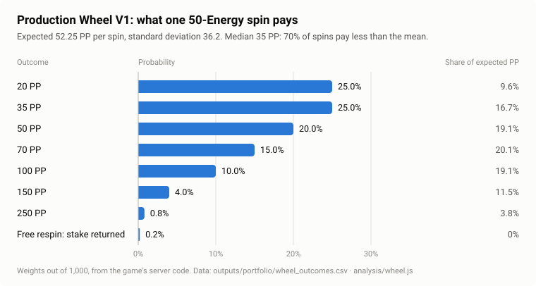

# Wheel Economics: Distribution, Scaling and Stake Tiers

*Companion to the [README](v1_core_economy.md). Every number on this page is computed by [`analysis/wheel.js`](../analysis/wheel.js) and written to [`outputs/portfolio/`](../outputs/portfolio) by [`analysis/build_portfolio.js`](../analysis/build_portfolio.js).*

The wheel is where Energy becomes progress. Players earn Energy by walking and spend it on spins, and each spin pays Progress Points (PP) that move them along a journey. This page covers four things:
- the reviewed probability table;
- what follows from it mathematically;
- why letting players choose very small stakes caused a presentation problem;
- how the 10 / 50 / 100 tiers of Wheel V3 solve it without changing the economy.

| Version | What it is | Status |
|---|---|---|
| **Wheel V1** | One spin at a fixed 50 Energy | **Implemented** in the game's server code |
| **Wheel V2** | The same table, with stakes of 1, 2, 3, 5, 10, 20, 50 or 100 Energy | **Development only.** A local implementation behind a debug-only flag, disabled by default. Not production |
| **Wheel V3** | Three fixed tiers: 10, 50 and 100 Energy | **Offline demo.** Implemented and tested in the isolated offline product demo, with the Odyssey Compass. Not production |

The values are provisional design values. They will be tuned after playtesting with real people.

## 1. The reviewed table (Wheel V1)

The server draws one of eight outcomes with integer weights out of 1,000 and returns the outcome's index. The app only animates to it. Nothing the player does during the animation can change the result.

| Outcome at 50 Energy | Weight | Probability | Contribution to the mean | Share of expected PP |
|---|---|---|---|---|
| 20 PP | 250 | 25.0% | 5.00 | 9.6% |
| 35 PP | 250 | 25.0% | 8.75 | 16.7% |
| 50 PP | 200 | 20.0% | 10.00 | 19.1% |
| 70 PP | 150 | 15.0% | 10.50 | 20.1% |
| 100 PP | 100 | 10.0% | 10.00 | 19.1% |
| 150 PP | 40 | 4.0% | 6.00 | 11.5% |
| 250 PP | 8 | 0.8% | 2.00 | 3.8% |
| Free respin: no PP, stake returned | 2 | 0.2% | 0 | 0% |
| **Total** | **1,000** | **100%** | **52.25** | **100%** |



## 2. Expected value and spread

For one 50-Energy attempt, with outcome *i* paying *aᵢ* PP with probability *pᵢ*:

| Quantity | Formula | Value |
|---|---|---|
| Expected PP per attempt | E[PP] = Σ pᵢ·aᵢ | **52.25** |
| Second moment | E[PP²] = Σ pᵢ·aᵢ² | 4,041.25 |
| Standard deviation | √(E[PP²] − E[PP]²) = √1,311.19 | **36.21** |
| Coefficient of variation | SD ÷ mean | 0.69 |
| Median outcome | | **35 PP** |
| Attempts paying less than the mean | P(PP < 52.25) | **70.2%** |
| Refund probability | | 0.2% |
| Expected Energy actually spent | 50 × (1 − 0.002) | 49.9 |
| PP per Energy staked | 52.25 ÷ 50 | **1.045** |
| PP per net Energy | 52.25 ÷ 49.9 = 1,045 ÷ 998 | **1.0471** |

**Design reading.**
- The distribution is right-skewed. Most spins pay a little below the mean and a few pay well above it, which is what makes a spin exciting.
- No single outcome dominates the expected value: the middle four outcomes contribute 19–20% each.
- The rarest outcome, 250 PP, carries only 3.8% of the mean, so it creates excitement without being something a player could farm.

**Two accounting conventions describe the same wheel.**
- *Per attempt*, used here and in the pilot lab: the refund outcome counts as an attempt that pays nothing and costs nothing.
- *Per paid spin*, used in the [legacy analysis](legacy_case_study_2026-10.md): the respin is a free redraw and is not counted. The expected PP per paid spin is 52.25 ÷ 0.998 = 52.35.
- The two give the same PP per net Energy: 1.0471.

## 3. Scaling with the stake (Wheel V2, development only)

Wheel V2 keeps the same eight outcomes and weights and scales each payout by the stake:

> payout(stake) = base PP × stake ÷ 50

Every quantity that matters scales the same way:

| | Formula | Consequence |
|---|---|---|
| Expected PP | 1.045 × stake | Return per Energy is **identical at every stake** |
| Expected Energy spent | 0.998 × stake | The refund share does not depend on the stake |
| Standard deviation | 0.724 × stake | The coefficient of variation is 0.69 at every stake |
| Steps per attempt | 10 × stake | Only the size of a single attempt changes |

This is a deliberate design property. A player who walks a given number of steps expects the same progress whatever stakes they choose. The stake changes only the *texture* of play: many small spins or a few large ones, and correspondingly smaller or larger swings. Nobody can improve their expected progress by betting big, so there is no reason to.

| Stake | Steps per attempt | Payouts | Expected PP | SD | Share of outcomes with fractional PP |
|---|---|---|---|---|---|
| 1 | 10 | 0.4 – 5 | 1.045 | 0.72 | **65%** |
| 2 | 20 | 0.8 – 10 | 2.09 | 1.45 | **65%** |
| 3 | 30 | 1.2 – 15 | 3.135 | 2.17 | **65%** |
| 5 | 50 | 2 – 25 | 5.225 | 3.62 | **25%** |
| 10 | 100 | 4 – 50 | 10.45 | 7.24 | 0% |
| 20 | 200 | 8 – 100 | 20.9 | 14.48 | 0% |
| 50 | 500 | 20 – 250 | 52.25 | 36.21 | 0% |
| 100 | 1,000 | 40 – 500 | 104.5 | 72.42 | 0% |

## 4. The fractional-reward problem

At small stakes the scaled payouts are not whole numbers. A 20-PP outcome at stake 1 is worth 0.4 PP; a 35-PP outcome at stake 5 is worth 3.5 PP.

**How the development implementation handles it.** It stores rewards in tenths of a PP, credits whole points and carries the remainder (0 to 9 tenths) in a server-side field. The accounting is exact. The presentation is not:

- The wheel's labels show the 50-Energy base amounts whatever the stake, so a wedge reading "20" pays 0.4.
- A spin that earns 0.4 PP usually adds no visible progress: unless the hidden remainder already holds 6 tenths or more, the player sees +0 PP.
- At stakes 1 to 3, **65% of all outcomes** are fractional. A player choosing the cheapest stakes sees "+0 PP" or a decimal on most spins.

**When are all payouts whole?** Each payout is aᵢ × stake ÷ 50. The binding case is 35 PP:
- 35 × stake ÷ 50 = 7 × stake ÷ 10, a whole number only when the stake is a multiple of 10;
- the 20-PP outcome needs a multiple of 5;
- so every payout is whole **exactly when the stake is a multiple of 10**.

## 5. Wheel V3: three tiers (offline demo)

V3 keeps the reviewed table and allows only stakes that are multiples of 10:

| Tier (demo name) | Stake | Steps per spin | Payouts | Expected PP | Jerusalem (1,500 PP): PP-budget approximation | Jerusalem: exact expected attempts | Exact expected net Energy |
|---|---|---|---|---|---|---|---|
| Quick Spin | 10 | 100 | 4, 7, 10, 14, 20, 30, 50 | 10.45 | ≈ 143.5 | 144.23 | 1,439 |
| Journey Spin | 50 | 500 | 20, 35, 50, 70, 100, 150, 250 | 52.25 | ≈ 28.7 | 29.40 | 1,467 |
| Epic Spin | 100 | 1,000 | 40, 70, 100, 140, 200, 300, 500 | 104.5 | ≈ 14.4 | 15.05 | 1,502 |

**Approximation versus exact.**
- **The PP-budget figure** is 1,500 ÷ expected PP per attempt. It is an approximation that ignores overshoot.
- **The exact figure** is the expected first-passage time from 0 PP. With A(r) the expected attempts while r PP are still needed, A(r) = (1 + Σ pᵢ·A(r − aᵢ)) ÷ (1 − 0.002), with A(r ≤ 0) = 0. Each refund counts as an attempt.
- **Energy.** By Wald's identity, expected net Energy = stake × 0.998 × expected attempts.
- **Overshoot** adds about 0.69 attempts at every stake. In Energy, that cost grows with the stake.
- **Checks.** A Monte Carlo run agrees, and every stake's figures are in [`outputs/portfolio/wheel_by_stake.csv`](../outputs/portfolio/wheel_by_stake.csv).

Each tier also includes the 0.2% refund outcome.

**What V3 preserves.**
- The same probabilities.
- The same 1.045 PP per Energy staked and 1.0471 PP per net Energy.
- The same PP-budget cost of Jerusalem: about 1,433 net Energy, or 14,325 credited steps, at any tier. Counting overshoot, the exact expected cost is higher and grows with the tier (table above).

**What V3 changes.**
- Every payout is a whole number, so the remainder disappears.
- Three named choices replace eight chips.

**What the offline demo implements.** The demo (not production) has:
- exactly the three tiers;
- a compass that labels each point with the **actual payout for the selected tier**;
- a "Reveal now" control that settles the needle on the already-drawn sector within 420 ms;
- **frozen receipts**: each draw is recorded, with the balances before it, before the animation starts, and leaving the screen cannot undo it or grant a reroll;
- **single settlement**: a receipt settles once, and a stale or repeated settlement is refused;
- refund handling that returns the stake;
- the internal fractional carry, which V3's whole payouts leave at zero;
- below 10 Energy, a disabled spin button that says how much more Energy is needed, keeps the remaining Energy and offers a way back to walking.

Its tests pin, among other things:
- the 40 / 70 / 100 / 140 / 200 / 300 / 500 payouts at 100 Energy;
- that "Reveal now" keeps every original landing sector;
- that the removed stakes are rejected;
- that 9 Energy cannot start a spin and is kept.

The demo's developer reports 76 passing tests, clean static analysis, a successful web build, a complete mobile browser walkthrough and no observed external requests. This repository did not re-run them. The list above comes from reading the demo's source and tests.

**Trade-offs of V3.**

| Concern | Detail |
|---|---|
| First spin for a new player | A new account starts at 0 Energy. The first Quick Spin needs 100 steps, where stake 1 needed 10 |
| Energy below the smallest tier | Up to 9 Energy (90 steps) waits for the next spin. It is kept, not lost |
| Larger swings at Epic | One Epic Spin ranges from 40 to 500 PP. The expected value is the same; only the variance is larger |
| Tier names | "Epic" can suggest better odds. The odds are identical on every tier, and the interface should say so |
| Competition | Neutral for progress, but in a PP-scored contest the tier is a variance lever: a trailing player does best on Epic. This is one reason competition is planned on a dedicated Odyssey Score, not PP. See [planned systems §5](planned_systems.md#5-odyssey-duels) |
| Odds communication | Equal-size compass points look like equal odds, but 250 PP comes up 0.8% of the time. Whether to size points by probability or show an odds panel is open |

## 6. Presentation rules

These rules apply to any wheel presentation:
- **The server decides the outcome before the animation starts.** The animation only presents it.
- **"Reveal now" shortens the animation.** It is never a "Stop" button, so tap timing cannot look like skill.
- **The deceleration follows one fixed curve.** There are no staged near-misses that crawl past a large prize.

## 7. Reproduce

```bash
node analysis/build_portfolio.js   # writes outputs/portfolio/*.csv and *.svg
node analysis/check_claims.js      # recomputes the figures quoted in the docs and checks the outputs are current
```

The per-stake table above is [`outputs/portfolio/wheel_by_stake.csv`](../outputs/portfolio/wheel_by_stake.csv). The outcome table is [`outputs/portfolio/wheel_outcomes.csv`](../outputs/portfolio/wheel_outcomes.csv).
