# Full Economy V2: Designing the Long Game of a Walking Economy

*Or Hotoveli · November 2026 · portfolio case study · a projection layer on top of the [V1 economy lab](../../docs/v1_core_economy.md)*

> **Projection, not observation.** Every player here is synthetic and nothing has been validated with real players. Journeys 1-7 keep their implemented PP costs; journeys 8-100 are placeholders. Every rate, price and reward that is not linked to V1 code is a **hypothetical** input, chosen to map the design space, not proposed for launch. Wheel V3 (Quick 10 / Journey 50 / Epic 100) is offline-demo functionality, not production.

## The design question

> How do we design a walking game's economy so that early progression feels accessible, missions become increasingly valuable, paid purchases accelerate access without buying physical progress, and cosmetics create meaningful long-term currency sinks?

V1 showed that the 30-tester pilot runs out of content within days. V2 asks what happens over the whole planned **100-destination World Tour**, when journeys cost **Chronons** and players can also earn them from missions, buy them in the Wellness Store or as bundles, and spend them on cosmetics.

## In three minutes

**The approach.** A closed-form ledger first (expected values, one steady walker), then a day-by-day simulation of 200 synthetic players per cohort over six years, with the reviewed wheel table, Wheel V3 tiers, missions, puzzles, store, bundles and cosmetics. Every hypothetical value lives in one configuration file, every result is reproducible from a fixed seed, and a checker recomputes every number quoted on this page.

| # | Finding | Label |
|---|---|---|
| 1 | **Two clocks set the pace.** A journey finishes only when walking has produced its PP *and* the player has paid its price. Early in the reference tour the PP clock binds; from journey 60 the Chronon clock does | Derived · Simulated |
| 2 | **For walking-only players, where scarcity starts is a property of the catalog, not of the player.** The same steps earn Energy and organic Chronons, so casual, moderate and active walkers all first wait at journeys 60, 60 and 61. Walking more only shortens the wait: 37, 19 and 9 days before journey 100 | Simulated · Derived |
| 3 | **Missions are worth most to the players who walk least.** A mission pays per event, not per step. Removing late-game waits takes about 1 mission a week for a casual walker, 1.5 for a moderate one and 3 for an active one | Simulated |
| 4 | **Late-game scarcity becomes blocked sessions and Energy inflation, not a slower walk.** With no spins allowed without an active journey, a Chronon-bound player banks Energy through the whole wait, then completes the next journey the moment it unlocks. In the reference calibration 54% of a walking-only player's sessions in the tour are fully blocked | Simulated |
| 5 | **The free path never deadlocks under the approved rule.** Organic Chronons keep accruing while waiting, so every price is reachable: moderate walking-only players finish on day 952. Without that rule, 100% of them are stuck for good | Simulated |
| 6 | **Spending accelerates access without buying progress.** A $4.99-a-month bundle buyer finishes on day 767 and a Store shopper on day 892, against day 952 walking only. Neither changes the Energy credited or the PP per Energy (tested) | Simulated (hypothetical prices) |
| 7 | **The Store can fund its rewards, if refunds are handled.** A median $45 order earns 12 Chronons, worth $1.74 at the bundle price, against $2.92 of commission. The reward only breaks even at 21.7%, or 10.8% if every store Chronon displaces a bundle sale | Derived (hypothetical inputs) |
| 8 | **Cosmetics: timing beats amount.** Buying from a surplus costs +13 days of tour time while still buying 23 of the 28 starter items; reserving 20% of every Chronon costs +432 days | Simulated |

**Where to look.** [Generated results and the fifteen questions](results.md) · [interactive lab](../dashboard/index.html) (open the file in a browser) · [all tables](../outputs) · [offline demo audit](demo_audit.md) · [how to run it](../README.md).

## 1. What is fixed and what is hypothetical

| Element | Value used | Label | Source |
|---|---|---|---|
| Steps to Energy | 10 verified steps = 1 Energy; PP only from spins; PP cannot be bought | Implemented | `pilot_model.js` (linked) |
| Wheel | Reviewed table: 52.25 PP per 50-Energy attempt, 0.2% refund. V3 tiers 10 / 50 / 100 at 1.045 PP per staked Energy | Implemented table · V3 offline demo | `analysis/wheel.js` (linked) |
| Journeys 1-7 | Jerusalem, Dead Sea, Petra, Cappadocia, Burj Khalifa, Acropolis, Santorini at 1,500 × 1.08ⁿ⁻¹ PP | Implemented; their World Tour placement is hypothetical | `assumptions.csv` (pinned by a test) |
| Journeys 8-100 | Placeholders in prerequisite tiers of three; PP from a pacing curve | Hypothetical | V2 projection |
| Chronons while waiting | Organic Chronons keep accruing when no journey is active | Approved for V2; the opposite is tested as a failure | V2 brief |
| Pending PP | Kept, applied in full to the next unlocked journey, never pays a price | Approved (planned direction) | V2 brief, V1 `PROGRESSION_RULES` |
| Energy cap | None as the analytical baseline; 250 and 500 compared, on step Energy only | Baseline is not a production decision (production: 250; the offline demo stops step credit at 500) | V1 docs, offline demo |
| Daily bonuses | Off in the baseline, tested separately | Implemented | V1 `LEGACY_BONUSES` |
| Reference mission | 2 km → 90 pieces + 5 Chronons, paid once | Provisional demo value (linked; confirmed in the demo's code, where it is a sponsored quest) | `pilot_model.js`, offline demo |
| Jaffa Gate puzzle | 3 × 3 tiles, 30 pieces per tile, 100 Energy once | Provisional demo value (linked; confirmed in the demo's code) | `pilot_model.js`, offline demo |
| Tile reveals | Pay nothing; Chronon rewards per tile only as a separate experiment | Documented; confirmed in the demo's code (see §2.4) | V1 docs and lab engine, offline demo |
| Everything else | Organic rate 1 Chronon per 1,000 steps, completion reward 1 per 100 PP, prices, mission supply, store and bundle rates, cosmetic prices | **Hypothetical** | [`config/scenario_config.js`](../config/scenario_config.js) |

## 2. How the model works

### 2.1 Architecture

Everything V2 adds lives in `full_economy_v2/`; no V1 file is modified. The engine is plain JavaScript with no packages, written so the same files run in the tests, the build script and the browser lab:

| Module | Job |
|---|---|
| `config/scenario_config.js` | The single registry of hypothetical values, with labels, units, ranges and the eleven player cohorts |
| `config/cosmetics_catalog.js` | 28 proposed cosmetic items; the validator refuses any field that could carry a gameplay effect |
| `engine/wheel_v3.js` | Wheel V3 on the reviewed table, in expected-value and sampled modes |
| `engine/projection_catalog.js` | The 100-journey projection, its PP and price schedules, and a wrapper that runs V1's catalog validator on it |
| `engine/journey_ledger.js` | The closed-form steady-walker ledger |
| `engine/simulation.js` | The day-by-day player simulation, with every Chronon tracked by source |
| `engine/business.js` | Store and bundle unit economics |

### 2.2 One simulated day

On each day a player opens the app:
1. **Mission.** At most one; walked the same day. Verified completion pays its pieces and Chronons once, and adds only the *extra* part of the route to the day's steps, so no step is counted twice.
2. **Sync.** Energy at 10 steps each (optional cap), organic Chronons and pieces per 1,000 verified steps.
3. **Store and bundles.** Store Chronons stay pending until the return window closes; bundles credit at once. Purchases never touch Energy, PP or progress.
4. **Puzzles.** Whole tiles from one general piece pool; each puzzle pays its completion Energy once.
5. **Journeys.** With no active journey, unlock the next one once its price is held; pending PP applies in full. Spin Wheel V3 tiers with all spinnable Energy. Completion pays the Chronon reward and sends the overshoot to pending PP.
6. **Cosmetics,** by the player's spending policy.

Steps on days without a session are lost unless backfill is on, as in V1. Walking, missions, the wheel, the store and cosmetic preferences each draw from their own random stream, so two cohorts with the same activity profile walk exactly the same steps: every comparison is paired.

### 2.3 The two clocks, in closed form

Run time on a steps clock *T*: cumulative verified steps. Journey *k* can finish once *T* × PP-per-step covers the PP of journeys 1..*k*, and it can start once the player holds its price:

```
unlock(k)   = max( finish(k-1),  steps at which the Chronon balance reaches price(k) )
finish(k)   = max( unlock(k),    steps whose PP covers journeys 1..k )
```

With no cap, Energy banked while waiting is spent the moment the next journey opens, which is why a Chronon-bound journey completes instantly on unlock. Because a walking-only player's Energy and Chronons both scale with *T*, the journey where `unlock` first exceeds `finish` does not depend on how many steps a day the player walks. The ledger and the simulation agree to within two days on a steady walker (tested).

### 2.4 What the offline demo confirms

Tile reveals are modelled as paying nothing: V1's lab engine only spends pieces on a tile, the catalog format has no per-tile reward slot, and the documentation describes only Jaffa Gate's one-time 100-Energy completion bonus. A read-only [audit of the Flutter offline demo's source](demo_audit.md) confirms it. A tile reveal only spends 30 pieces; the ninth tile sets a single completion flag worth 100 Energy, which lands in the wallet the wheel spends. A mission pays 90 pieces and 5 Chronons once, and only at check-in after its simulated 2 km walk; the demo allows three missions per session, exactly one puzzle. Steps make only Energy, each step once, and the demo stops crediting them once the wallet holds 500. Two model rules are assumptions rather than demo behaviour: the demo's mission distance makes no steps or Energy, while the model credits the extra part of the route as steps; and the demo's only quest is sponsored, while the model also pays its reward for organic missions. Unlocking a further journey is a one-off concept whose price of 5, 10 or 15 Chronons is marked hypothetical: no journey price has been approved. Organic Chronons and pieces, completion rewards, the store, bundles and cosmetics are not in the demo. Chronons per tile appear only in a labelled experiment (§4.4).

## 3. The World Tour projection

**Pacing (PP).** Journeys 1-7 keep the implemented costs. Extending the implemented 8% growth to journey 100 would make it cost 3,055,224 PP, so V2 models three separate pacing curves after Santorini: flat (234,725 PP for the tour), gentle growth (338,755 PP, the reference) and 8% capped at 3 × Jerusalem (423,225 PP).

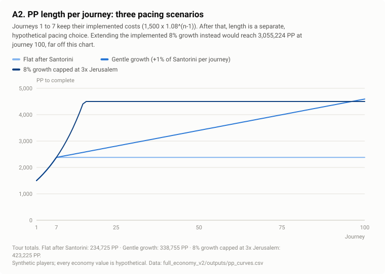

**Prices (Chronons).** The reference is a **coverage-targeted hybrid**: the designer chooses the *coverage* of each journey (Chronons a walking-only player earns during the previous journey, divided by the price) at journeys 2, 10, 40 and 100 (1.3, 1.2, 0.95, 0.7), and prices follow. Prices are calibrated once and frozen, so changing the pacing curve or the organic rate never silently reprices journeys. The linear, exponential, piecewise and milestone families are scaled to the hybrid's total of 7,443 Chronons, so they differ only in *when* they charge.

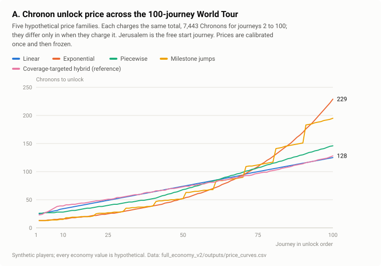

**Validation.** The projection is also written in V1's catalog format and passes V1's validator through a wrapper (V1's format accepts only two catalog statuses, so the wrapper checks V2's own label itself; `world_tour.js` is unchanged): 0 errors, valid but not ready, since the era transition reward and the next era are still undecided. The per-journey economy (tier, prerequisites, PP, price, expected walking, organic Chronons, completion reward, balance on completion, expected delay) is in [`journey_economy.csv`](../outputs/journey_economy.csv).

## 4. Results

### 4.1 Walking only: where Chronon scarcity starts

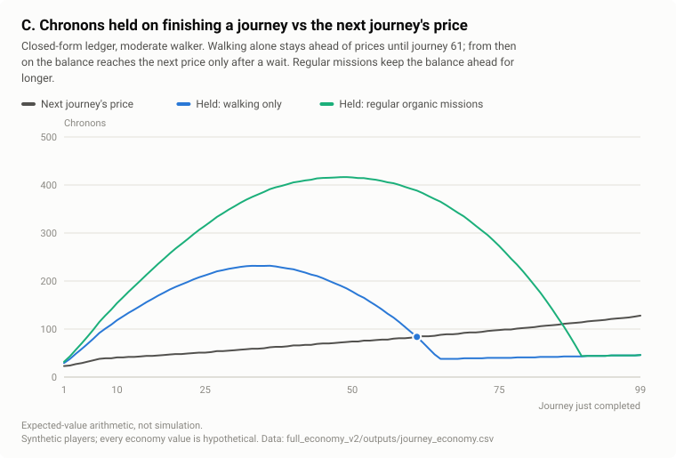

Early prices sit below what a journey's walking earns, so a surplus builds. Once coverage falls below one, the surplus drains and the balance on finishing a journey stops covering the next price. In the simulation the median moderate walker first waits at journey 60, and casual and active walkers first wait within a journey of it:

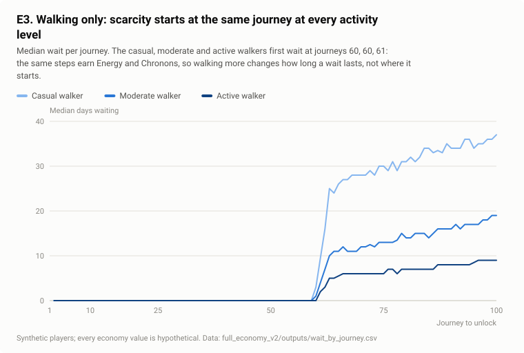

Moderate walking-only players finish the tour on day 952 (99% within six years). Casual walking-only players are slower on both clocks: only 49% finish within six years.

### 4.2 Missions: organic and sponsored

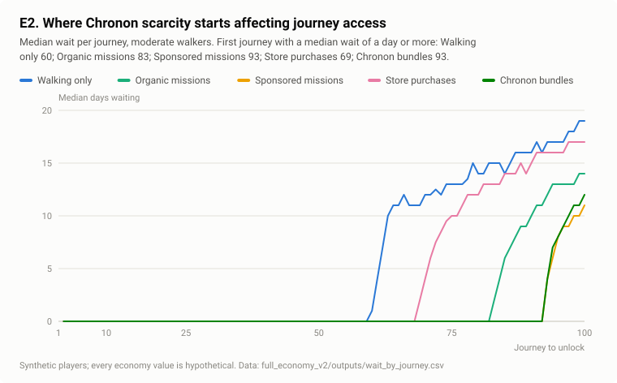

Regular organic missions (1.18 a week) move the first wait from journey 60 to journey 83 and finish the tour on day 761; with a sponsor in reach (1.67 missions a week) the first wait moves to journey 93 and the tour ends on day 699. Missions add only 8.8% (organic) and 11.6% (sponsored) of a player's Chronons, but they arrive exactly where walking falls short:

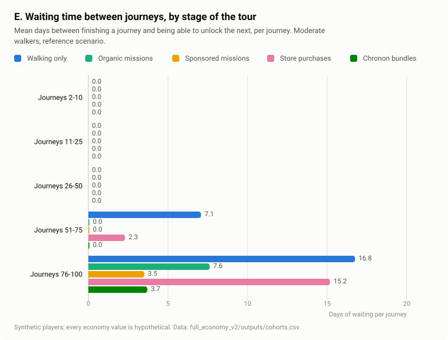

Organic missions are what keep the mission system open to everyone: a player with no partner nearby still finishes 191 days ahead of walking only, and only 62 days behind a player with a sponsor in reach. How many missions are enough depends on the player (missions per week for a median wait of a day or less over journeys 76-100):

| Walker | Missions per week needed |
|---|---|
| Casual | 1 |
| Moderate | 1.5 |
| Active | 3 |

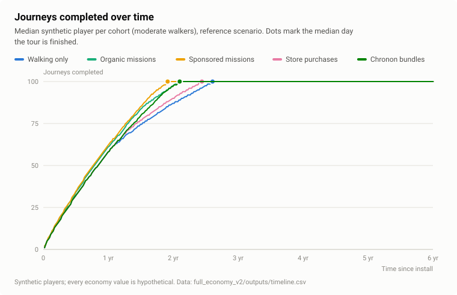

### 4.3 Purchases: the Wellness Store and Chronon bundles

> **Hypothetical commercial inputs.** Every price, bundle size, order value, reward rate, commission rate, platform fee and refund rate in this section is a hypothetical modelling input chosen to map the design space. None is a production price or an approved business decision, and no partner, commission or bundle terms exist.

**How a purchase becomes Chronons.** Chronons = eligible order value × reward rate ÷ the dollar value of one Chronon, and that value comes only from the bundle price ($4.99 for 31 Chronons, about $0.16 each). A "5% reward" therefore means Chronons worth 5% of the order *at the bundle price*. Chronons are not cash and cost nothing to create; their business cost is the bundle revenue they displace.

**Player side.** At a 5% reward, about $56 a month of shopping brings journey 100 forward from day 952 to day 864; about $110 a month at 10% brings it to day 742. The reference shopper (one order every 45 days, about $37 a month) finishes on day 892.

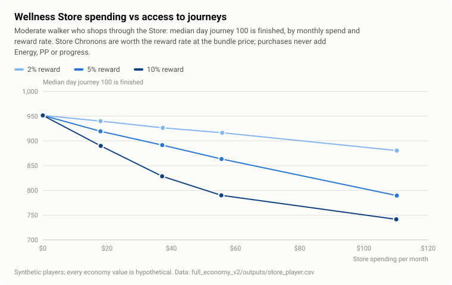

**Business side.** Commission is revenue to the game and is never equated with the Chronons awarded. At 8% commission and a 30% platform fee on bundles, the reward rate breaks even at 21.7% if half of store Chronons displace bundle purchases, and at 10.8% if all of them do. Crediting Chronons only after the return window avoids clawback debt entirely; with no clawback, a 30% refund rate leaks 54 Chronons per shopper-year and cuts the store's net from $24.91 to $21.69 per shopper-year.

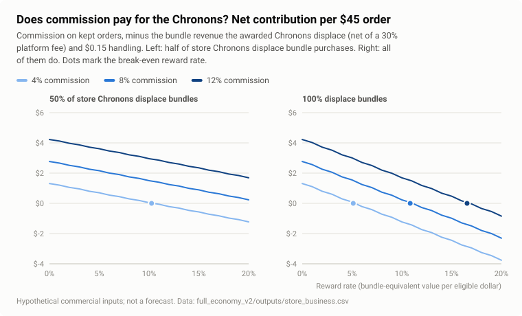

### 4.4 Future Vision puzzles

With one puzzle per destination (Jaffa Gate's provisional settings generalised as a labelled assumption), a moderate walker completes 27.6 puzzles a year without missions and 52.7 with high participation and a sponsor in reach. With Jaffa Gate alone, the only defined puzzle, the loop ends after one completion.

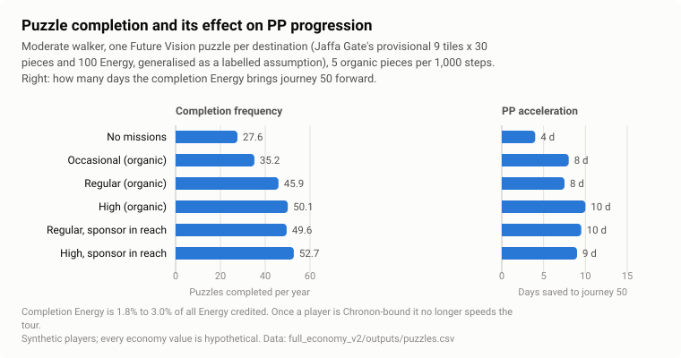

Completion Energy is 1.8% to 3.0% of all Energy credited. It brings journey 50 forward by 4 to 10 days, but it cannot help a Chronon-bound player, so journey 100 moves by 0 to 21 days. **Tile-reward experiment:** a single Chronon per tile, earned from pieces that themselves come from walking and missions, cuts walking-only blocked sessions from 54% to 27% and the tour from day 952 to day 820. A tile reward would be a large new faucet that has to be priced into coverage, not a free extra.

### 4.5 Cosmetics as a sink

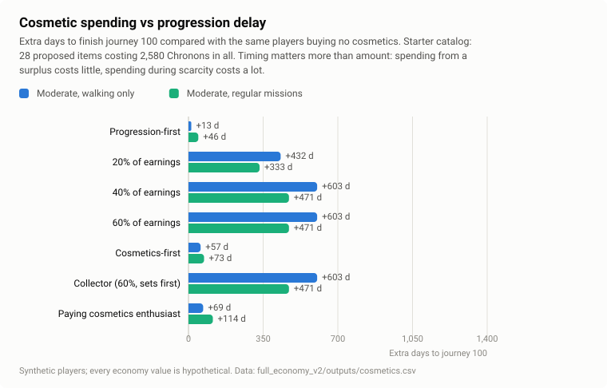

The starter catalog is 28 proposed items in four categories (characters, pets, clothing, futuristic equipment), priced in weeks of a moderate walker's organic income: 25, 60, 125 and 250 Chronons by rarity, 2,580 in all. Every item is cosmetic only, enforced by the catalog validator.

- **Progression-first** buying (only from a surplus, never touching the next journey's price) costs +13 days and still buys 23 of 28 items.
- **Reserving a share of every Chronon** costs +432 days at 20% and +603 days at 40% or 60%, when the catalog runs out and the reserve returns to journeys.
- **Cosmetics-first** costs only +57 days: it spends the early surplus, when Chronons are cheap in tour time.

The same Chronon costs almost nothing in the surplus phase and about a day of tour time per 4.4 Chronons (a moderate walker's daily organic income) in the Chronon-bound phase. A finite catalog is a finite sink: once it is bought, cosmetics stop absorbing Chronons, so a long-term sink needs a release cadence.

### 4.6 Sources, sinks and inflation

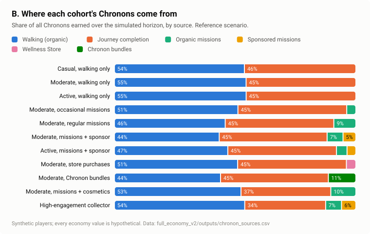

Walking-only players earn 55% of their Chronons from walking and 45% from completion rewards. The Chronon balance builds during the surplus phase and is drawn down once prices overtake coverage. The Energy balance tells the other half of the story:

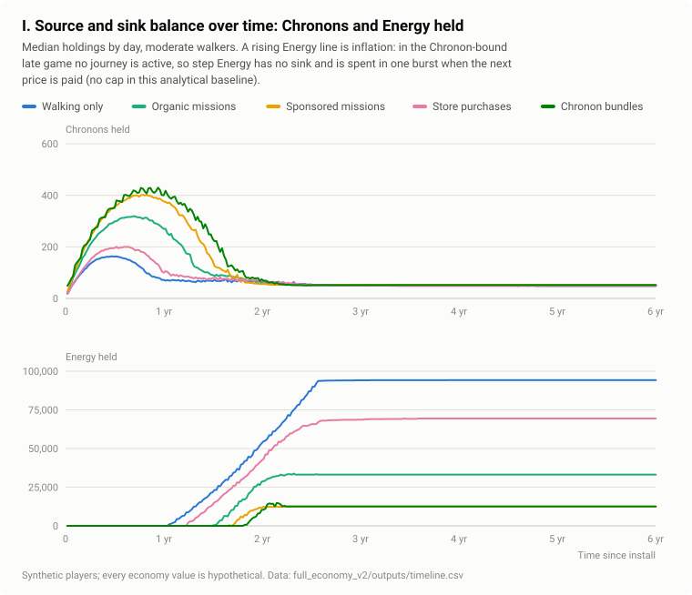

In the Chronon-bound phase step Energy has no sink: 60% of a moderate walking-only player's step Energy is credited while no journey is active, and on finishing the tour they still hold about 94,000 Energy, about 211 days of their walking that never moved them forward. Missions and bundles shrink that bank because they remove the waits that create it.

### 4.7 Price families and pacing scenarios

All five budget-matched price families get the moderate walking-only player to journey 100 within a day of each other, around day 952: the total Chronon cost, not its timing, decides when a Chronon-bound tour ends. Timing decides *how the wait feels*:

| Family | First wait | Sessions blocked | Wait before journey 100 (days) |
|---|---|---|---|
| Coverage-targeted hybrid | journey 60 | 54% | 19 |
| Linear | journey 64 | 51% | 18 |
| Piecewise | journey 80 | 40% | 23 |
| Milestone jumps | journey 91 | 31% | 34 |
| Exponential | journey 92 | 30% | 42 |

Back-loaded curves block fewer sessions overall but concentrate the longest waits at the very end. No completion target is assumed; the pacing scenarios show the trade-off between tour length and scarcity:

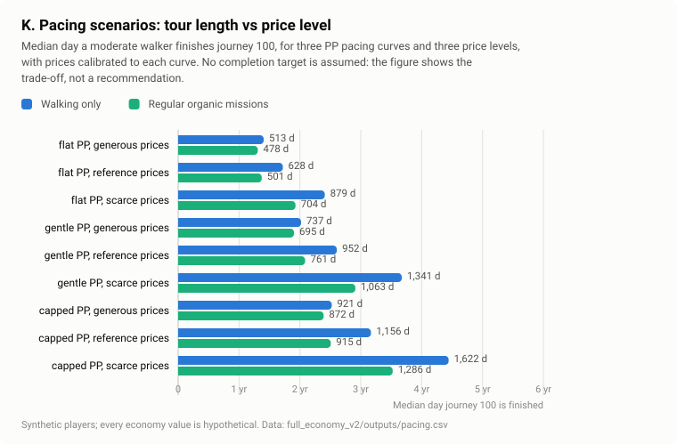

- With a flat tour and generous prices, a moderate walker finishes on day 513 with no waits, and 97% of casual walkers finish within six years.
- With the 8% capped tour and scarce prices, the moderate walker needs until day 1,622, and only 5% of casual walkers finish.

**Keeping PP and price growth separate matters.** With prices frozen, a longer PP tour can finish *sooner*: the flat tour takes 1,190 days and the capped tour 921, because completion rewards scale with PP and longer journeys pay more Chronons.

The balance sweep varies late-game coverage alone:

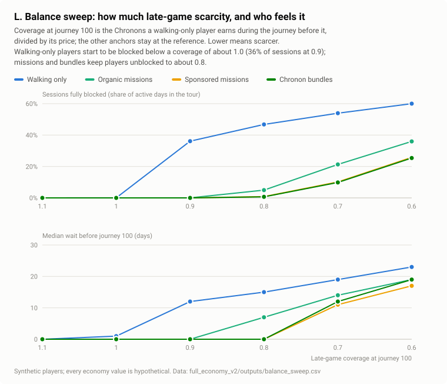

- **At coverage 1.0** walking-only players are never blocked.
- **At 0.9** they are blocked in 36% of sessions, while mission and bundle players are not blocked at all.
- **At 0.8** organic-mission players are blocked in 5% of sessions.
- **At 0.7, the reference,** walking-only players are blocked in 54% of sessions and organic-mission players in 21%.

### 4.8 Sensitivity and stress

| Lever (moderate, walking only; base: day 952) | Low | High |
|---|---|---|
| Organic Chronon rate, 0.5x / 2x | day 1,909 | day 737 |
| Price level, scarce / generous coverage | day 1,341 | day 737 |
| Completion reward, 0.5x / 2x | day 1,349 | day 737 |
| Energy cap, 250 / 500 | day 1,799 | day 974 |

- **The PP floor.** Day 737 is the PP floor of the gentle tour for a moderate walker: once Chronons stop binding, no Chronon setting makes the tour shorter.
- **Daily bonuses.** Turning them on moves the first wait from journey 60 to journey 37 and changes nothing else: more Energy without more Chronons only brings scarcity forward.
- **The production cap.** A 250 cap with one sync a day makes every cohort, missions and purchases included, finish around day 1,800.
- **Price growth.** From a fixed start, growth of up to 1.5% per journey still lets one mission a week finish the whole tour in two years; at 2% it falls just short (a median of 99.5 journeys). From 2.5% per journey, no mission frequency tested, up to four a week, finishes it.

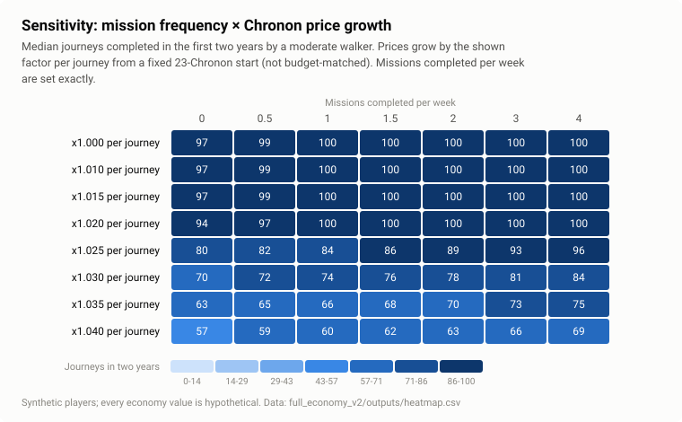

**Lower participation.** With mission acceptance down to occasional, organic-mission players finish on day 882 instead of 761. With store orders down to a third, shoppers finish on day 929 instead of 892. The walking-only path is unchanged in every case, so the free experience never depends on commercial participation.

**The wheel's luck.** Sampled outcomes and expected values give the same median day for journey 100 in all five key cohorts, so expected values are adequate at tour scale; variance matters for short contests, as V1 showed.

## 5. Failure modes identified

1. **Deadlock if Chronons stop while waiting.** 100% of walking-only players are stuck. Missions, purchases and bundles avoid it but are slow: organic-mission players need until day 2,000.
2. **Blocked sessions and Energy inflation in the Chronon-bound phase.** The game can make a walking-only player wait, but under the current rules it cannot make them wait *a little*: each Chronon-bound journey is a fully blocked wait followed by an instant completion.
3. **A low cap with one daily sync paces everything,** and makes missions and purchases irrelevant to access.
4. **Price growth above about 2% per journey from a fixed start,** which no realistic mission frequency keeps up with.
5. **Store rewards without clawback** leak Chronons through refunds. Rewards above break-even lose money once displaced bundle revenue is counted.
6. **A finite cosmetic catalog** stops being a sink once complete. A spending reserve that kept accruing after the catalog ran out would starve journeys for no purpose; the model releases it.
7. **Long PP tours exclude casual walkers** before Chronons even matter: on the gentle tour, even prices generous enough that they never wait leave 22% of casual walkers unfinished after six years.

## 6. Recommendations

These are design directions supported by the runs above, not final prices or rates.

1. **Set the tour's length (the PP clock) first.** It is the floor no Chronon setting can beat, and it decides whether casual walkers can finish at all.
2. **Design prices as coverage, not as a price list.** Coverage at or above 1 keeps walking-only players PP-bound. The stated hypothesis (accessible early, missions increasingly valuable, sustainable for mission players) corresponds to late-game coverage of roughly 0.8 to 1.0, where walking-only waits appear late and missions or bundles remove them.
3. **Give waiting time something to do, or avoid long Chronon-bound stretches.** As long as no spins can happen without an active journey and the bank is uncapped, every Chronon-bound journey is a blocked wait plus a burst. Options to evaluate, none decided:
   - keep late coverage near 1;
   - let a player choose and start walking toward the next journey before paying;
   - give banked Energy a non-PP use while waiting.
4. **Keep organic Chronons accruing while waiting.** It is the reason deadlock is impossible.
5. **Decide deliberately whether completion rewards scale with PP.** If they do, longer journeys are a Chronon source and pacing changes move the Chronon clock too.
6. **Credit store Chronons after the return window, keep the reward rate well below the full-displacement break-even, and set the store and bundle rates as a pair.**
7. **Price cosmetics in weeks of income, surface them when the player has a surplus, and plan a release cadence.**
8. **If tile rewards are adopted, count them as part of the organic faucet** and re-run coverage.
9. **Choose the Energy cap from measured sessions per day,** not in isolation.

## 7. Open decisions

- Target tour length and acceptable waiting.
- Late-game coverage.
- Whether completion rewards scale with PP.
- The organic Chronon and piece rates.
- Mission supply, both sponsored and organic.
- Rewards for short and long missions.
- Whether every destination has a puzzle, and the size and reward of later puzzles.
- Tile rewards.
- The Energy cap and its treatment during waits.
- Store reward rate, commission terms, refund policy and platform-policy review of rewarding external purchases with virtual currency.
- Bundle sizes and prices.
- Cosmetic catalog cadence.
- The Coins-to-Chronons migration.
- Arrival quests versus walking missions.
- The era transition and the economy of the next era.

## 8. Live-playtesting requirements

A 28-day pilot sees only the first journeys, so V2's late-game findings cannot be confirmed in it.

**What the pilot can measure:**
- sessions per day and the balance at each sync (the cap question);
- daily steps by segment;
- the mission funnel, including organic missions and extra walking;
- puzzle pieces and tile choices;
- stated tolerance for waiting (a survey on days 3 and 28).

**What needs longer cohorts or staged releases:**
- tolerance of real late-game waits;
- cosmetic demand at real prices;
- store conversion and refunds;
- retention.

**Instrumentation to add:**
- `session_blocked`: no journey active and none affordable;
- `energy_banked_at_unlock`;
- Chronons earned and spent, by source and sink;
- cosmetic purchases with the balance and the next price at that moment.

## 9. Validation and reproduction

```bash
node full_economy_v2/scripts/run_tests.js   # V2 tests (root `node --test` still runs exactly V1's suite)
node full_economy_v2/scripts/build_v2.js    # regenerate every V2 table, figure and results.md (about a minute)
node full_economy_v2/scripts/check_v2.js    # outputs current, quoted numbers recomputed, links, V1 checks still green
```

**What the tests cover:**
- agreement between the closed-form ledger and the simulation;
- conservation of Energy, Chronons by source, pieces and PP on 40 random scenarios;
- no negative wallets;
- purchases never touching Energy or PP;
- no spins without a journey;
- pending PP never paying a price;
- each step and mission counted once and each puzzle bonus paid once;
- the deadlock failure scenario;
- refund policies;
- cosmetic delays ordered by share;
- reproducibility from the seed;
- V1's validator on the projection.

**Mutation tests.** `node full_economy_v2/scripts/mutation_check.js` breaks 13 safeguards one at a time in a throwaway copy and confirms that each break turns at least one test red. The breaks include paying the puzzle bonus at eight tiles, crediting Energy from a bundle, rewarding a mission twice and letting pending PP pay part of a price.

## 10. Limitations

- **Synthetic players only.** Activity, sessions, mission funnels, shopping and cosmetic preferences are assumptions; there is no retention model, and results describe players who keep playing for six years.
- **Hypothetical economy values.** Every economy value not linked to V1 is hypothetical, and so is the projection's structure after journey 7.
- **One sync per active day.** The simulation assumes this, as V1's lab does; more sessions would soften any cap.
- **Simplified unlock order.** Journeys within a tier are interchangeable, so unlock order follows the index.
- **Simplified stores and bundles.** Store orders and bundles are scheduled behaviour, not decisions.
- **Out of scope.** Competition (Leagues, Duels, Odyssey Score), Coins, arrival quests and the next era are not modelled.

*AI assistance: I built this extension with Claude (Anthropic). Claude wrote the model, tests and analysis code and drafted the text from my game's rules and my brief. I set the questions and the design decisions, reviewed the results and directed the corrections.*
